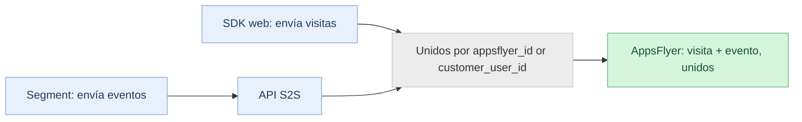

> **At a glance:** La API S2S para la Medición del performance web te permite enviar visitas web y eventos a AppsFlyer directamente desde tu Servidor, eludiendo las limitaciones del navegador, como los bloqueadores de anuncios y las restricciones de cookies. Úsala junto con el SDK web o por sí sola para obtener Datos de atribución más completos y de mayor calidad y mejor recursos.

<div id="about-the-s2s-api-for-web-attribution" />

## Sobre la API S2S para la atribución web

AppsFlyer admite dos formas de enviar datos web para la Atribución: el SDK web (del lado del cliente) y la API S2S (server-to-server, o S2S). Puedes usar cualquiera de los dos métodos de forma independiente o combinarlos según tu configuración y tus necesidades.

El SDK web se ejecuta en el navegador. La API S2S te permite enviar los mismos datos desde tu propio backend. Aquí es donde entra en juego: los navegadores centrados en la privacidad y los bloqueadores de anuncios, como Safari ITP, Firefox ETP y Brave, pueden bloquear o limitar la medición del lado del cliente. Las estimaciones del sector sitúan el bloqueo a nivel de navegador entre el 25 y el 40% de los usuarios web. Como las llamadas S2S se originan en tu servidor y nunca pasan por el navegador, no se ven afectadas en absoluto por estas restricciones.

<div id="how-it-works" />

### Cómo funciona

1. Un usuario visita tu sitio web o activa un evento en el navegador.
2. Tu servidor recibe el evento.
3. Tu servidor envía el evento directamente al servidor de AppsFlyer para su atribución.

<div id="why-use-s2s" />

### ¿Por qué usar S2S?

Esto es lo que implica para ti usar la API S2S, desglosado por ventaja:

* **Medir eventos del lado del servidor:** Algunas conversiones nunca pasan por el navegador, por ejemplo, las renovaciones de suscripciones procesadas en el backend o los eventos que se originan en un sistema CRM. S2S es la única forma de incorporarlos a AppsFlyer y vincularlos a la campaña correcta.
* **Mayor cobertura de medición:** Las llamadas S2S provienen de tu servidor, no del navegador, por lo que los bloqueadores de anuncios, los límites de cookies de Safari ITP y otras restricciones a nivel del navegador no se aplican. Puedes registrar visitas y conversiones que la medición del lado del cliente por sí sola no detectaría.
* **Enriquecimiento de datos desde el backend:** Con S2S, tu Servidor puede añadir datos adicionales a los eventos antes de enviarlos, incluidos los ID de Usuario del cliente, el correo electrónico hashed o los números de teléfono hashed, los atributos de CRM, el estado de suscripción o cualquier identificador interno. Esto mejora la resolución de identidades y fortalece la calidad de la señal.
* **Seguridad:** Las claves de desarrollador, los identificadores de usuario y cualquier dato adicional permanecen en tu servidor y se envían a través de una conexión segura, lo que te brinda un control total sobre lo que sale de tu infraestructura.

<div id="api-specification" />

## Especificación de la API

URL base: `https://events.appsflyer.com`

<div id="authentication" />

### Autenticación

Todas las solicitudes deben incluir un token válido de la API S2S y el tipo de contenido correcto en los encabezados de la solicitud.

| Encabezado | Tipo | Description |
| --- | --- | --- |
| `Autorización` | Token de API: | Tu token de la API S2S se incluye en el encabezado con el siguiente formato:<br /><br />`Authorization: Bearer {s2s-token}` |
| `Tipo de contenido` | string | Debe ser `application/json`. Obligatorio en todas las solicitudes. |

<div id="note" />

> 📘 **Nota**
>
> Para crear un token de la API S2S, consulta las instrucciones en <Anchor target="_blank" href="/marketers/es/docs/managing-appsflyer-tokens#gestiona-tus-tokens">Gestión de tokens de AppsFlyer</Anchor>.

<div id="measure-an-event" />

### Medir un evento

`POST /v2.0/s2s/inapps/app/web/{appId}`

Mide un evento web (por ejemplo, una compra, un registro o una acción personalizada) para una aplicación determinada.

<Accordion title="Parámetro de ruta">

| Parámetro | Requerido | Description |
| --- | --- | --- |
| `appId` | Requerido | El `unified_app_id` tal como se define en AppsFlyer. Por ejemplo: `website-www.example.com` |

</Accordion>

<Accordion title="Cuerpo de la solicitud">

| Campo | Tipo | Requerido | Description |
| --- | --- | --- | --- |
| `user_id` | objeto | Requerido | Identificador de usuario. Debe contener al menos uno de estos campos: `customer_user_id` o `appsflyer_id`. |
| `nombre_del_evento` | string | Requerido | Nombre del evento. 1–64 caracteres. No puede contener `@ = + -`. Ejemplo: `af_purchase` |
| `ingresos_evento` | número (doble) | Opcional | Importe de ingresos para eventos de compra o monetización. |
| `moneda_ingresos_evento` | string (ISO-4217) | Opcional | Código de moneda del valor de ingresos. Por ejemplo, `USD` o `EUR`. |
| `event_value` | objeto | Opcional | Parámetros de evento de formato libre. Admite un subobjeto `custom_parameters`. |
| `event_url` | string | Opcional | URL de la página donde se produjo el evento. URL HTTP válida, máximo 4.096 caracteres. |
| `timestamp` | integer (int64) | Opcional | Hora Unix en ms (UTC). Si se omite, AppsFlyer usa la hora de recepción. Ventana de aceptación tardía: los eventos deben llegar como muy tarde a las 00:30 del siguiente día natural en la zona horaria de la aplicación. |
| `ip` | string | Opcional | Dirección IP del dispositivo (IPv4 o IPv6). Máximo 46 caracteres. |
| `agente_usuario` | string | Opcional | String completo del agente de usuario del navegador. Máximo 1,024 caracteres. |
| `http_referrer` | string | Opcional | URL de referencia de la página actual. |
| `af_customer_event_id` | string | Opcional | Tu propio ID único para el evento, que usas para eliminar duplicados de conversiones en plataformas de ad network. AppsFlyer lo reenvía a la red como ID del evento.<br /><br />Envíalo cuando se cumpla cualquiera de estos casos:<ul><li>Ejecutas un píxel de red en tu sitio junto con la medición de AppsFlyer.</li><li>Envías el mismo evento a través del SDK web y de esta API.</li></ul>Cuando lo envíes, envía también el mismo valor en el evento de píxel propio de la red (por ejemplo, `eventID` en `fbq()`), para que la red cuente la conversión una vez en lugar de dos.<br /><br />Si lo omites, AppsFlyer genera su propio ID y la red no puede hacer coincidir tus eventos de píxel.<br /><br />**Límites:** Máximo 256 caracteres. La coincidencia es exacta y distingue entre mayúsculas y minúsculas. |
| `correo_electrónico_hashed` | string | Opcional | SHA256 del correo electrónico normalizado (en minúsculas y sin espacios al principio ni al final). Debe ser una string hexadecimal de 64 caracteres. |
| `phone_number_hashed` | string | Opcional | SHA256 del número de teléfono. Debe ser una string hexadecimal de 64 caracteres. |
| `phone_number_e164_hashed` | string | Opcional | SHA256 del número de teléfono en formato E.164 (por ejemplo, `+14155552671`). Debe ser una string hexadecimal de 64 caracteres. |
| `first_name_hashed` | string | Opcional | SHA256 del nombre normalizado. Debe ser una string hexadecimal de 64 caracteres. |
| `last_name_hashed` | string | Opcional | SHA256 del apellido normalizado. Debe ser una string hexadecimal de 64 caracteres. |

</Accordion>

<Accordion title="Ejemplo de solicitud">

```json
{"user_id":{"customer_user_id":"15667737-366d-4994-ac8b-653fe6b2be4a"},"event_name":"af_purchase","event_revenue":49.99,"event_revenue_currency":"USD","af_customer_event_id": "550e8400-e29b-41d4-a716-446655440000","event_value":{"af_content_id":"SKU-001","af_quantity":2,"custom_parameters":{"promo_code":"SUMMER10"}},"event_url":"https://example.com/checkout/success","timestamp":1712000000000,"ip":"35.244.183.10","user_agent":"Mozilla/5.0 (Macintosh; Intel Mac OS X 10_15_7) ...","email_hashed":"a1b2c3d4e5f6a1b2c3d4e5f6a1b2c3d4e5f6a1b2c3d4e5f6a1b2c3d4e5f6a1b2"}
```

</Accordion>

<Accordion title="Respuestas">

| Estado | Descripción |
| --- | --- |
| 202 Aceptado | Solicitud aceptada. Devuelve el estado, el mensaje y `messageId` opcional. |
| 400 Solicitud incorrecta | Campos no válidos o ausentes. |
| 401 No autorizado | La aplicación no existe o la autenticación ha fallado. |
| 403 Prohibido | El tráfico de la app está bloqueado. |
| 415 Tipo de medio no compatible | `Content-Type` debe ser `application/json`. |

</Accordion>

<div id="measure-a-visit" />

### Medir una visita

`POST /v2.0/s2s/visits/app/web/{appId}`

Mide una visita de página para una aplicación web determinada. Este endpoint comparte todos los campos base con el endpoint de evento, con dos diferencias clave: `event_url` es obligatorio y los campos de nombre del evento e ingresos no se aplican.

<Accordion title="Parámetro de ruta">

| Parámetro | Requerido | Descripción |
| --- | --- | --- |
| `appId` | Requerido | El `unified_app_id` tal como se define en AppsFlyer. Por ejemplo: `website-www.example.com` |

</Accordion>

<Accordion title="Cuerpo de la solicitud">

| Campo | Tipo | Requerido | Descripción |
| --- | --- | --- | --- |
| `user_id` | objeto | Requerido | Identificador de usuario. Debe contener al menos uno de `customer_user_id` o `appsflyer_id`. |
| `event_url` | string | Requerido | La URL de la página visitada. URL HTTP válida, máximo 4.096 caracteres. |
| `timestamp` | integer (int64) | Opcional | Hora Unix en ms (UTC). Si se omite, AppsFlyer usa la hora de recepción. Ventana de aceptación tardía: las visitas deben llegar no más tarde de las 00:30 del siguiente día natural en la zona horaria de la aplicación. |
| `ip` | string | Opcional | Dirección IP del dispositivo (IPv4 o IPv6). Máximo 46 caracteres. |
| `agente_usuario` | string | Opcional | String completo del agente de usuario del navegador. Máximo 1.024 caracteres. |
| `http_referrer` | string | Opcional | URL de referencia de la página actual. |
| `event_value` | objeto | Opcional | Parámetros de evento de formato libre, incluidos un subobjeto `custom_parameters`. |
| `af_customer_event_id` | string | Opcional | Tu propio ID único para el evento, que usas para deduplicar conversiones en plataformas de ad network. AppsFlyer lo reenvía a la red como ID del evento.<br /><br />Envíalo si se cumple alguno de estos casos:<ul><li>Ejecutas un píxel de red en tu sitio junto con la medición de AppsFlyer.</li><li>Envías el mismo evento a través del SDK web y de esta API.</li></ul>Cuando lo envíes, envía también el mismo valor en el propio evento de píxel de la red (por ejemplo, `eventID` en `fbq()`), para que la red contabilice la conversión una vez en lugar de dos.<br /><br />Si lo omites, AppsFlyer genera su propio ID y la red no puede asociar tus eventos de píxel.<br /><br />**Límites:** Máximo 256 caracteres. La coincidencia es exacta y distingue entre mayúsculas y minúsculas. |
| `email_hashed` | string | Opcional | SHA256 del correo electrónico normalizado. Debe ser una string hexadecimal de 64 caracteres. |
| `phone_number_hashed` | string | Opcional | SHA256 del número de teléfono. Debe ser una string hexadecimal de 64 caracteres. |
| `phone_number_e164_hashed` | string | Opcional | SHA256 del número de teléfono en formato E.164. Debe ser una string hexadecimal de 64 caracteres. |
| `first_name_hashed` | string | Opcional | SHA256 del nombre normalizado. Debe ser una string hexadecimal de 64 caracteres. |
| `last_name_hashed` | string | Opcional | SHA256 del apellido normalizado. Debe ser una string hexadecimal de 64 caracteres. |

</Accordion>

<Accordion title="Ejemplo de solicitud">

```json
{"user_id":{"appsflyer_id":"1234567890abcdef","customer_user_id":"15667737-366d-4994-ac8b-653fe6b2be4a"},"af_customer_event_id": "550e8400-e29b-41d4-a716-446655440000","event_url":"https://example.com/products/sneakers","timestamp":1712000000000,"ip":"35.244.183.10","user_agent":"Mozilla/5.0 (Windows NT 10.0; Win64; x64) ...","http_referrer":"https://www.google.com/","email_hashed":"a1b2c3d4e5f6a1b2c3d4e5f6a1b2c3d4e5f6a1b2c3d4e5f6a1b2c3d4e5f6a1b2"}
```

</Accordion>

<Accordion title="Respuestas">

| Estado | Description |
| --- | --- |
| 202 Aceptado | Solicitud aceptada. Devuelve el estado, el mensaje y el `messageId` opcional. |
| 400 Solicitud incorrecta | Campos no válidos o ausentes. |
| 401 No autorizado | La app no existe o la autenticación falló. |
| 403 Prohibido | El tráfico de la aplicación está bloqueado. |
| 415 Tipo de medio no admitido | El `Content-Type` debe ser `application/json`. |

</Accordion>

<div id="set-up-a-fully-server-side-integration" />

## Configurar una integración completamente del lado del servidor.

Si estás ejecutando el SDK web junto con S2S, usa [Extracción del afUserID del SDK web](#extracting-the-web-sdk-afuserid) en su lugar. Esta sección es solo para integraciones sin SDK.

Si no estás ejecutando el SDK web en tu sitio, eres responsable de todo lo que normalmente gestionaría: asignar la cookie de usuario, enviar los identificadores correctos y mantener completo el payload de cada evento. Si lo haces bien, esta configuración te ofrece todas las ventajas descritas en [Por qué usar S2S](#por-qué-usar-s2s), pero depende de que estos detalles estén correctos.

<Accordion title="Envía visitas, no solo eventos">

Una visita incluye los parámetros de atribución de los que depende cada evento posterior, y el sistema espera una visita antes de cualquier evento del usuario. Si envías un evento antes de una visita, el sistema lo clasifica como orgánico.

</Accordion>

<Accordion title="Asigna una cookie propia mediante HTTP">

Como no hay ningún SDK web que configure por ti la cookie `afUserId`, debes asignarla y gestionarla tú mismo como una cookie HTTP configurada en la cabecera de respuesta `Set-Cookie`, no como una cookie del lado del cliente escrita en JavaScript.

Por eso es importante: una cookie del lado del cliente (configurada mediante `document.cookie`) caduca rápidamente, en tan solo 7 días en Safari o 24 horas en dominios bajo ITP. Cuando caduca, el identificador se restablece y un visitante recurrente parece nuevo. Una cookie configurada por tu servidor no está sujeta a ese límite y puede mantenerse hasta el máximo permitido por el navegador (Chrome permite hasta 400 días). También se puede marcar como `HttpOnly`, por lo que los scripts de la página y los bloqueadores de anuncios no pueden leerla ni eliminarla, y además no depende en absoluto de que se ejecute ningún script en la página.

Para configurarla y leerla:

1. En la primera solicitud de un visitante sin cookie, genera en tu servidor un ID estable y único (por ejemplo, un UUID).
2. Devuélvelo en una cookie propia:

   ```
   Set-Cookie: af_web_id=<generated-id>; Max-Age=34128000; Path=/; Secure; HttpOnly; SameSite=Lax
   ```
3. En cada solicitud posterior, lee el valor de la cabecera Cookie entrante y reutilízalo. No lo regeneres.
4. Envía ese valor a AppsFlyer en cada llamada como `appsflyer_id` como parte del objeto `user_id` de la solicitud.

Puedes ponerle a la cookie el nombre que quieras; AppsFlyer lee el valor que envías, no el nombre de la cookie. Solo asegúrate de configurarla desde tu propio dominio de primera parte.

</Accordion>

<Accordion title="Envía los identificadores correctos en cada llamada">

Cada llamada necesita un objeto `user_id` con al menos uno de estos identificadores: `appsflyer_id` (el valor de la cookie) o `customer_user_id` (tu ID interno de usuario). Enviar ambos, cuando los tengas, mejora la resolución de identidad.

Esto es lo que debes recordar: las visitas son mayoritariamente anónimas, así que envía siempre el valor de la cookie. En los eventos del sitio, añade `customer_user_id` una vez que se identifique al usuario y sigue enviando la cookie junto con él. En los eventos que no se originan en el navegador, `customer_user_id` por sí solo es suficiente, siempre que AppsFlyer ya conozca a ese usuario por una sesión identificada anterior.

</Accordion>

<div id="things-to-consider" />

## Cosas a considerar

<Accordion title="Identificación de usuario">

El objeto `user_id` es obligatorio en todas las solicitudes. Debes proporcionar al menos uno de los siguientes identificadores.

| Campo | Tipo | Description |
| --- | --- | --- |
| `id_usuario_cliente` | string (1–64 caracteres) | Tu identificador interno de usuario, tal como está definido en tu sistema. |
| `appsflyer_id` | string (mín. 1 carácter) | Identificador interno de AppsFlyer para el usuario web. Si usas el SDK web de AppsFlyer, el valor de `appsflyer_id` se obtiene de la cookie del SDK web. Extráelo de `afUserId`. Consulta [Cómo extraer el afUserId del SDK web](#extracting-the-web-sdk-afuserid) |

</Accordion>

<Accordion title="Ventanas de aceptación tardía">

Los eventos y las visitas deben recibirse como máximo a las 00:30 del siguiente día natural, según la zona horaria de la aplicación. Los eventos tardíos pasan a usar la hora de recepción del servidor.

</Accordion>

<Accordion title="Campos de PII hashed">

Todos los campos de datos personales deben estar hashed con SHA256 antes de enviarse. Normaliza el texto (en minúsculas y sin espacios al principio ni al final) antes de aplicar hashing. Cada hash debe tener exactamente 64 caracteres hexadecimales (sin distinguir entre mayúsculas y minúsculas).

* Patrón para todos los campos hashed: `^[a-fA-F0-9]{64}$`
* Los números de teléfono que usan el campo `phone_number_e164_hashed` deben ajustarse al formato E.164 (por ejemplo, `+14155552671`) antes del hashing.

</Accordion>

<Accordion title="Extraer el afUserID del SDK web">

* El parámetro `afUserId` es un identificador único que establece el SDK web cuando un usuario visita tu sitio por primera vez.
* Si necesitas `afUserId`, utiliza uno de los métodos que se indican a continuación.

<span id="h_01HKW2YAW5FK04C3AWCXGP1XAW"></span>**Obtener el afUserId del encabezado de la cookie HTTP**

* El `afUserId` lo envía el navegador del visitante en las llamadas a tu sitio.
* Extráelo del encabezado de la cookie HTTP si es necesario.

<span id="h_01HKW2YAW5CT2WZ229KJD2FWYK"></span>**Ver el afUserId en el navegador del visitante**

* Visualiza el `afUserId` en el navegador del visitante para solucionar problemas y depurar.
* Para que esté disponible, el visitante tiene que haber visitado primero una página que tenga el SDK web al menos una vez.
* La cookie que contiene `afUserId` es una cookie de origen en relación con tu dominio.
* El siguiente procedimiento se preparó con Chrome 81. Puede haber diferencias entre navegadores y sistemas operativos.

**Para obtener el afUserId del navegador del visitante:**

1. En tu navegador, ve a tu sitio web.
2. Haz clic con el botón derecho y selecciona ***Inspeccionar***. Se abre la ventana de inspección de elementos del navegador.
3. Ve a la pestaña (A) ***Aplicación***.
4. En el menú lateral, (B) expande Cookies.
5. Selecciona tu sitio web. Si no aparece, actualiza el navegador.
6. En el campo (C) ***filtro***, introduce `afUserId`. Se muestra el valor de afUserID.

</Accordion>

<div id="send-events-via-segment-cdp" />

## Envía eventos a través de Segment (CDP)

**Puedes usar Segment para enrutar eventos a tu API S2S.** (Segment es una plataforma de datos de clientes, una herramienta que se usa para recopilar eventos de clientes y enviarlos a los destinos configurados)

El SDK web y Segment son dos rutas independientes y paralelas hacia AppsFlyer, no una alimenta a la otra: el SDK web sigue enviando visitas, que incluyen los parámetros de atribución, y Segment envía eventos para las propiedades que no tienen el SDK. Ninguna de las dos rutas conoce la otra; AppsFlyer es donde se unen, vinculando una visita con sus eventos mediante el identificador que envías en ambas.



El SDK web y Segment son dos rutas paralelas hacia AppsFlyer, unidas por un identificador compartido.

<div id="note-1" />

> 📘 **Nota:**
>
> Esto abarca los eventos **web** enviados mediante S2S desde un destino personalizado de Segment. Para el wrapper del SDK móvil de Segment, que conecta las instalaciones de la app y los eventos in-app con el SDK móvil de AppsFlyer, consulta en su lugar la <Anchor target="_blank" href="/marketers/es/docs/segment-integration">integración con Segment</Anchor>; se trata de una integración distinta para una plataforma diferente.

<Accordion title="Configura el destino en Segment">

AppsFlyer todavía no tiene un destino de Segment predefinido para la API S2S, así que tendrás que configurarlo como un destino personalizado en Segment que envíe cada evento al endpoint de S2S. Hay dos formas de hacerlo, según cuánto control necesites sobre el formato de los datos.

<div id="option-1-webhooks-actions-destination" />

#### Opción 1: destino de Webhooks (acciones)

Este es el punto de partida recomendado. No requiere código y toda la configuración se hace en la interfaz de usuario de Segment.

Para configurarlo:

1. En Segment, añade el destino de Webhooks desde el catálogo de destinos.
2. Conéctalo a la fuente que recopila los eventos que quieres enviar.
3. Para cada tipo de evento, crea una asignación que defina la URL de AppsFlyer, establezca el método en POST, añada los encabezados obligatorios y genere el payload JSON a partir de los campos del evento.

<div id="option-2-destination-function" />

#### Opción 2: función de destino

Usa esta opción solo si la asignación de Webhooks no puede generar el formato de payload que necesita AppsFlyer. Una Destination Function es una pequeña función de JavaScript que se ejecuta dentro de Segment, recibe cada evento y lo envía al endpoint de AppsFlyer mediante fetch.

Usa esta opción cuando:

* El payload necesita una estructura anidada, por ejemplo, envolver `user_id` dentro de un objeto `user`, que la interfaz de usuario de asignación de Webhooks no puede generar.
* Los datos del evento deben transformarse antes de enviarse, por ejemplo, convirtiendo una timestamp a un formato diferente.

</Accordion>

<Accordion title="El endpoint de AppsFlyer">

Independientemente de la configuración que uses, apúntala a este endpoint:

```
POST https://events.appsflyer.com/v2.0/s2s/inapps/app/web/website-{your_domain}

Authorization: Bearer {s2s-token}
Content-Type: application/json
```

Obtén tu clave de la API S2S en la página de gestión de tokens de AppsFlyer (consulta [Autenticación](#autenticación)). En la ruta, usa el ID de la app web (por ejemplo, `website-www.your_domain`), no el UUID del **Web SDK ID** en la página de configuración de la app.

</Accordion>

<Accordion title="Payload por evento">

Crea el cuerpo JSON de cada evento asignado con estos campos:

```json
{
  "user_id": {
    "customer_user_id": "<tu ID de usuario interno>",
    "appsflyer_id": "<valor de la cookie afUserId, cuando esté disponible>"
  },
  "event_name": "signup",
  "event_url": "<URL de la página donde se produjo el evento>",
  "ip": "<IP del usuario final>",
  "user_agent": "<user agent del usuario final>",
  "af_customer_event_id": "<messageId de Segment>"
}
```

</Accordion>

<Accordion title="Dos reglas para que la atribución funcione">

1. Mantén el SDK web en funcionamiento en el sitio de marketing: registra las visitas y Segment gestiona los eventos. Como se explica en la introducción de esta sección, un usuario necesita una visita antes de un evento; de lo contrario, el evento se atribuye como orgánico. Si en su lugar quieres una configuración totalmente del lado del servidor, sin ningún SDK web, sigue [Configura una integración totalmente del lado del servidor](#configurar-una-integración-completamente-del-lado-del-servidor).
2. Cada llamada también necesita los identificadores correctos: envía la misma combinación de `appsflyer_id` o `customer_user_id` descrita en [Envía los identificadores correctos en cada llamada](#af-accordion-11).

</Accordion>

<Accordion title="Verifica la configuración">

Cuando el destino y el payload estén listos, sigue estos tres pasos:

1. Asigna uno o dos eventos en Segment (el evento de registro es una buena primera opción) y envía un evento de prueba desde el probador de asignaciones.
2. Verifica que lleguen correctamente al reporte sin procesar y que coincidan con la visita al sitio de marketing.
3. Cuando lo hayas confirmado, amplía la asignación al resto de los eventos.

</Accordion>

<Accordion title="Despliegue sugerido">

Cuando el destino y el payload estén listos, sigue estos tres pasos:

1. Asigna uno o dos eventos en Segment (el evento de registro es una buena primera opción) y envía un evento de prueba desde el probador de asignaciones.
2. Verifica que lleguen correctamente al reporte sin procesar y que coincidan con la visita al sitio de marketing.
3. Cuando lo hayas confirmado, amplía la asignación al resto de los eventos.

</Accordion>

<div data-zendesk-anchors="about-the-s2s-api-for-web-attribution=sobre-la-api-s2s-para-la-atribuci%C3%B3n-web h_01KP13TF66KEZ7F1TGAA7RGQ6G=sobre-la-api-s2s-para-la-atribuci%C3%B3n-web how-it-works=c%C3%B3mo-funciona h_01KP13TF66W8V5A40YT2XYWQ5K=c%C3%B3mo-funciona why-use-s2s=por-qu%C3%A9-usar-s2s h_01KP13TF671CF85KMYXFZE6W9D=por-qu%C3%A9-usar-s2s api-specification=especificaci%C3%B3n-de-la-api h_01KP13TF67N1FVEAD1C7RV25TY=especificaci%C3%B3n-de-la-api authentication=autenticaci%C3%B3n h_01KP13TF67MHPEQ5J3H69RTQH5=autenticaci%C3%B3n h_01KT98N5SBW812PVXP165FCWR3=nota measure-an-event=medir-un-evento h_01KP13TF67QQC3F1YP9RZRNMTK=medir-un-evento measure-a-visit=medir-una-visita h_01KP13TF68HMD8GSR6GSY95WYF=medir-una-visita h_01KZS2SFULLSVR01=configurar-una-integraci%C3%B3n-completamente-del-lado-del-servidor set-up-a-fully-server-side-integration=configurar-una-integraci%C3%B3n-completamente-del-lado-del-servidor things-to-consider=cosas-a-considerar h_01KP13TF68F2T3P7P56A5EG2HW=cosas-a-considerar h_01M2T6JS6CPED929FVJS4P4CEG=env%C3%ADa-eventos-a-trav%C3%A9s-de-segment-cdp h_01M2T6JS6CJ75PG72RSRYTCV9N=nota-1 h_01M2T6JS6C08V4WZCC9EP724ZG=opci%C3%B3n-1-destino-de-webhooks-acciones h_01M2T6JS6CZVH4PVH6MK7X5VTZ=opci%C3%B3n-2-funci%C3%B3n-de-destino" />
