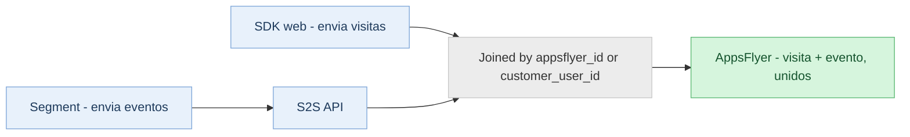

> **At a glance:** A API S2S para Mensuração de performance web permite que você envie visitas à web e eventos para a AppsFlyer diretamente do seu servidor, contornando limitações do navegador, como bloqueadores de anúncios e restrições de cookies. Use a API isolada ou junto ao Web SDK para obter dados de atribuição mais completos e com mais qualidade.

<div id="about-the-s2s-api-for-web-attribution" />

## Sobre a API S2S para atribuição web

A AppsFlyer disponibiliza duas maneiras de enviar dados da web para atribuição: o Web SDK (lado do cliente) e a API S2S (servidor para servidor). Você pode usar qualquer um dos métodos de forma independente ou combiná-los, dependendo da sua configuração e das suas necessidades.

O Web SDK é executado no navegador. Com a API S2S, você envia os mesmos dados a partir do seu próprio backend. Isso é importante porque navegadores e bloqueadores de anúncios focados na privacidade, incluindo Safari ITP, Firefox ETP e Brave, podem impedir ou limitar a mensuração do lado do cliente. Estimativas da indústria apontam que o bloqueio no nível do navegador afeta entre 25 e 40% dos usuários da web. Como as chamadas S2S têm origem no seu servidor e nunca passam pelo navegador, elas não são afetadas por essas restrições.

<div id="how-it-works" />

### Como funciona

1. Um usuário visita seu site ou aciona um evento no navegador.
2. Seu servidor recebe o evento.
3. Seu servidor envia o evento diretamente para o servidor da AppsFlyer para atribuição.

<div id="why-use-s2s" />

### Por que usar o S2S

Confira os benefícios de uso da API S2S:

* **Mensuração de eventos do lado do servidor:** Algumas conversões nunca passam pelo navegador. Exemplo: renovações de assinatura processadas no backend ou eventos com origem em um sistema de CRM. A API S2S é a única maneira de inseri-los na AppsFlyer e reconectá-los à campanha certa.
* **Maior cobertura de mensuração:** As chamadas S2S são provenientes do seu servidor, não do navegador. Portanto, os bloqueadores de anúncios, as restrições de cookies do Safari ITP e outras limitações no nível do navegador não se aplicam. Você pode registrar visitas e conversões que a mensuração do lado do cliente não detectaria.
* **Enriquecimento de dados a partir do backend:** Com S2S, seu servidor pode adicionar dados extras aos eventos antes de enviá-los, incluindo IDs de usuário do cliente, e-mail ou números de telefone com hash, atributos de CRM, status da assinatura ou quaisquer identificadores internos. Isso melhora a resolução da identidade e fortalece a qualidade do sinal.
* **Segurança:** Dev keys, identificadores de usuário e quaisquer dados adicionados permanecem no seu servidor e são enviados através de uma conexão segura, garantindo controle total sobre o que sai da sua infraestrutura.

<div id="api-specification" />

## Especificação da API

URL base: `https://events.appsflyer.com`

<div id="authentication" />

### Autenticação

Todas as solicitações devem incluir um token da API S2S válido e o tipo de conteúdo correto nos cabeçalhos.

| Cabeçalho | Tipo de valor esperado | A descrição |
| --- | --- | --- |
| `Autorização` | chave de API | O token da API S2S está incluído no cabeçalho da seguinte forma:<br /><br />`Autorização: Bearer {s2s-token}` |
| `Tipo de conteúdo` | string | Deve ser `application/json`. Obrigatória em todas as solicitações. |

<div id="note" />

> 📘 **Atenção**
>
> Para criar um token da API S2S, consulte as instruções em <Anchor target="_blank" href="/marketers/pt/docs/managing-appsflyer-tokens#gerencie-seus-tokens">Gerencie seus tokens da AppsFlyer</Anchor>.

<div id="measure-an-event" />

### Mensurar um evento

`POST /v2.0/s2s/inapps/app/web/{appId}`

Mensure um evento da web (por exemplo, uma compra, assinatura ou ação personalizada) para um determinado aplicativo.

<Accordion title="Parâmetros do path">

| Parâmetro | Obrigatório | A descrição |
| --- | --- | --- |
| `appId` | Obrigatório | O `unified_app_id` conforme definido na AppsFlyer. Por exemplo: `website-www.example.com`. |

</Accordion>

<Accordion title="Corpo da solicitação">

| Campo | Tipo de valor esperado | Obrigatório | A descrição |
| --- | --- | --- | --- |
| `user_id` | objeto | Obrigatório | Identificador do usuário. Deve conter pelo menos um `customer_user_id` ou `appsflyer_id`. |
| `DMA (área de mercado designada)` | string | Obrigatório | Nome do evento. 1 a 64 caracteres. Não pode conter `@ = + -`. Exemplo: `af_purchase` |
| `event_revenue` | número (duplo) | OPCIONAL | Valor da receita para eventos de compra ou monetização. |
| `Fonte de mídia do colaborador` | string (ISO-4217) | OPCIONAL | Código da moeda para o valor da receita. Exemplo: `USD` ou `EUR`. |
| `event_value` | objeto | OPCIONAL | Parâmetros de evento de formato livre. Compatível com um sub-objeto `custom_parameters`. |
| `event_url` | string | OPCIONAL | URL da página onde o evento ocorreu. URL HTTP válido, máximo de 4.096 caracteres. |
| `timestamp` | integer (int64) | OPCIONAL | Tempo Unix em ms (UTC). Se omitido, a AppsFlyer usa o tempo de recebimento. Janela de aceitação tardia: os eventos devem ser recebidos até, no máximo, 00h30 do dia seguinte, considerando o fuso horário do aplicativo. |
| `ip` | string | OPCIONAL | Endereço IP do dispositivo (IPv4 ou IPv6). Máximo de 46 caracteres. |
| `user_agent` | string | OPCIONAL | String completa do agente do usuário a partir do navegador. Máximo de 1.024 caracteres. |
| `http_referrer` | string | OPCIONAL | URL de referência da página atual. |
| `af_customer_event_id` | string | OPCIONAL | Seu próprio ID exclusivo do evento, que você usa para desduplicar conversões em plataformas de ad network. A AppsFlyer o encaminha para a network como o ID do evento.<br /><br />Envie-o quando uma destas situações se aplicar:<ul><li>Você executa um pixel da network no seu site, junto com a mensuração da AppsFlyer.</li><li>Você envia o mesmo evento pelo SDK web e por esta API.</li></ul>Ao enviá-lo, envie também o mesmo valor no evento de pixel da própria network (por exemplo, `eventID` em `fbq()`), para que a network conte a conversão uma vez em vez de duas.<br /><br />Se você omiti-lo, a AppsFlyer gera o próprio ID, e a network não consegue corresponder aos seus eventos de pixel.<br /><br />**Limites:** Máximo de 256 caracteres. A correspondência é exata e diferencia maiúsculas de minúsculas. |
| `email_hashed` | string | OPCIONAL | SHA256 do e-mail normalizado. Deve ser uma string hexadecimal de 64 caracteres. |
| `phone_number_hashed` | string | OPCIONAL | SHA256 do número de telefone. Deve ser uma string hexadecimal de 64 caracteres. |
| `phone_number_e164_hashed` | string | OPCIONAL | SHA256 do número de telefone no formato E.164 (por exemplo, `+14155552671`). Deve ser uma string hexadecimal de 64 caracteres. |
| `first_name_hashed` | string | OPCIONAL | SHA256 do primeiro nome normalizado. Deve ser uma string hexadecimal de 64 caracteres. |
| `last_name_hashed` | string | OPCIONAL | SHA-256 do e-mail normalizado (em letras minúsculas e sem espaços em branco no início e no fim). Deve ser uma string hexadecimal de 64 caracteres. |

</Accordion>

<Accordion title="Exemplo de solicitação">

```json
{"user_id":{"customer_user_id":"15667737-366d-4994-ac8b-653fe6b2be4a"},"event_name":"af_purchase","event_revenue":49.99,"event_revenue_currency":"USD","af_customer_event_id": "550e8400-e29b-41d4-a716-446655440000","event_value":{"af_content_id":"SKU-001","af_quantity":2,"custom_parameters":{"promo_code":"SUMMER10"}},"event_url":"https://example.com/checkout/success","timestamp":1712000000000,"ip":"35.244.183.10","user_agent":"Mozilla/5.0 (Macintosh; Intel Mac OS X 10_15_7) ...","email_hashed":"a1b2c3d4e5f6a1b2c3d4e5f6a1b2c3d4e5f6a1b2c3d4e5f6a1b2c3d4e5f6a1b2"}
```

</Accordion>

<Accordion title="Respostas">

| Estado | Visão geral |
| --- | --- |
| 202 Aceito | Solicitação aceita. Devolve status, mensagem e `messageId` opcional. |
| 400 Erro na solicitação | Campos inválidos ou ausentes. |
| 401 Não autorizado | O aplicativo não existe ou a autenticação falhou. |
| 403 Proibido | Todo o tráfego está bloqueado. |
| 415 Tipo de mídia não permitido | `Content-Type` deve ser `application/json`. |

</Accordion>

<div id="measure-a-visit" />

### Mensurar uma visita

`POST /v2.0/s2s/visits/app/web/{appId}`

Mensure uma visita à página de um determinado aplicativo web. Esse endpoint compartilha todos os campos básicos com o endpoint do evento, com duas diferenças principais: `event_url` é obrigatório, e os campos de nome do evento e receita não se aplicam.

<Accordion title="Parâmetros do path">

| Parâmetro | Obrigatório | Visão geral |
| --- | --- | --- |
| `appId` | Obrigatório | O `unified_app_id` conforme definido na AppsFlyer. Por exemplo: `website-www.example.com`. |

</Accordion>

<Accordion title="Corpo da solicitação">

| Campo | Tipo de valor esperado | Obrigatório | Visão geral |
| --- | --- | --- | --- |
| `user_id` | objeto | Obrigatório | Identificador do usuário. Deve conter pelo menos um `customer_user_id` ou `appsflyer_id`. |
| `event_url` | string | Obrigatório | O URL da página visitada. URL HTTP válido, máximo de 4.096 caracteres. |
| `timestamp` | integer (int64) | Opcional | Tempo Unix em ms (UTC). Se omitido, a AppsFlyer usa o tempo de recebimento. Janela de aceitação tardia: as visitas devem ser recebidas até, no máximo, 00h30 do dia seguinte, considerando o fuso horário do aplicativo. |
| `ip` | string | Opcional | Endereço IP do dispositivo (IPv4 ou IPv6). Máximo de 46 caracteres. |
| `user_agent` | string | Opcional | String completa do agente do usuário a partir do navegador. Máximo de 1.024 caracteres. |
| `http_referrer` | string | Opcional | URL de referência da página atual. |
| `event_value` | objeto | Opcional | Parâmetros de evento de formato livre, incluindo um sub-objeto `custom_parameters`. |
| `af_customer_event_id` | string | Opcional | Seu próprio ID exclusivo do evento, que você usa para deduplicar conversões em plataformas de ad network. A AppsFlyer encaminha isso para a network como o ID do evento.<br /><br />Envie-o quando uma destas condições se aplicar:<ul><li>Você executa um pixel da network no seu site, junto com a mensuração da AppsFlyer.</li><li>Você envia o mesmo evento pelo SDK web e por esta API.</li></ul>Ao enviá-lo, envie também o mesmo valor no evento de pixel da própria network (por exemplo, `eventID` em `fbq()`), para que a network contabilize a conversão uma vez, em vez de duas.<br /><br />Se você omiti-lo, a AppsFlyer gera o próprio ID, e a network não consegue corresponder aos seus eventos de pixel.<br /><br />**Limites:** Máx. 256 caracteres. A correspondência é exata e diferencia maiúsculas de minúsculas. |
| `email_hashed` | string | Opcional | SHA256 do primeiro nome normalizado. Deve ser uma string hexadecimal de 64 caracteres. |
| `phone_number_hashed` | string | Opcional | SHA256 do número de telefone. Deve ser uma string hexadecimal de 64 caracteres. |
| `phone_number_e164_hashed` | string | Opcional | SHA256 do número de telefone no formato E.164. Deve ser uma string hexadecimal de 64 caracteres. |
| `first_name_hashed` | string | Opcional | SHA256 do primeiro nome normalizado. Deve ser uma string hexadecimal de 64 caracteres. |
| `last_name_hashed` | string | Opcional | SHA-256 do e-mail normalizado (em letras minúsculas e sem espaços em branco no início e no fim). Deve ser uma string hexadecimal de 64 caracteres. |

</Accordion>

<Accordion title="Exemplo de solicitação">

```json
{"user_id":{"appsflyer_id":"1234567890abcdef","customer_user_id":"15667737-366d-4994-ac8b-653fe6b2be4a"},"af_customer_event_id": "550e8400-e29b-41d4-a716-446655440000","event_url":"https://example.com/products/sneakers","timestamp":1712000000000,"ip":"35.244.183.10","user_agent":"Mozilla/5.0 (Windows NT 10.0; Win64; x64) ...","http_referrer":"https://www.google.com/","email_hashed":"a1b2c3d4e5f6a1b2c3d4e5f6a1b2c3d4e5f6a1b2c3d4e5f6a1b2c3d4e5f6a1b2"}
```

</Accordion>

<Accordion title="Respostas">

| Estado | Visão geral |
| --- | --- |
| 202 Aceito | Solicitação aceita. Devolve status, mensagem e `messageId` opcional. |
| 400 Erro na solicitação | Campos inválidos ou ausentes. |
| 401 Não autorizado | O aplicativo não existe ou a autenticação falhou. |
| 403 Proibido | Todo o tráfego está bloqueado. |
| 415 Tipo de mídia não permitido | `Content-Type` deve ser `application/json`. |

</Accordion>

<div id="set-up-a-fully-server-side-integration" />

## Configurar uma integração total do lado do servidor

Se você estiver usando o Web SDK junto à API S2S, veja a seção [Como obter o afUserID do Web SDK](#extracting-the-web-sdk-afuserid). Esta seção é apenas para integrações sem SDK.

Se você não estiver usando o Web SDK no seu site, você é responsável por todas as suas funções: atribuir o cookie do usuário, enviar os identificadores corretos e manter todas as cargas de evento completas. Se realizada da maneira correta, essa configuração oferece todos os benefícios descritos na seção [Por que usar](#por-que-usar-o-s2s), mas somente se os detalhes estiverem certos.

<Accordion title="Envie visitas, e não apenas eventos">

Uma visita contém os parâmetros de atribuição dos quais todo evento subsequente depende, e o sistema espera uma visita antes de qualquer evento de usuário. Se você envia um evento antes de uma visita, o sistema classifica-o como orgânico.

</Accordion>

<Accordion title="Atribua um cookie first-party via HTTP">

Como você não usou o Web SDK para definir o cookie `afUserId`, você mesmo precisa atribuí-lo e gerenciá-lo, como um HTTP cookie definido no cabeçalho da resposta `Set-Cookie`, e não como um cookie do lado do cliente escrito em JavaScript.

Isso é importante porque um cookie do lado do cliente (definido via `document.cookie`) expira rapidamente: tão rápido quanto 7 dias no Safari ou 24 horas em domínios sob ITP. Depois que ele expira, o identificador é redefinido, e um visitante recorrente parece novo. Um cookie definido pelo seu servidor não está sujeito a essa limitação e pode permanecer armazenado até o período máximo permitido pelo navegador (o Chrome permite até 400 dias). Também pode ser marcado como `HttpOnly`, para que os scripts da página e os bloqueadores de anúncios não possam acessá-lo nem removê-lo, e ele não depende da execução de nenhum script na página.

Para configurá-lo e acessá-lo:

1. Na primeira solicitação de um visitante sem cookie, gere um ID estável e único no seu servidor (por exemplo, um UUID).
2. Retorne-o em um cookie first-party:

   ```
   Set-Cookie: af_web_id=<generated-id>; Max-Age=34128000; Path=/; Secure; HttpOnly; SameSite=Lax
   ```
3. Em cada solicitação posterior, leia o valor do cabeçalho do cookie recebido e reutilize-o. Não o gere novamente.
4. Envie esse valor para a AppsFlyer em todas as chamadas como parte de `appsflyer_id` do objeto `user_id` da solicitação.

Você pode nomear o cookie como quiser; a AppsFlyer lê o valor que você envia, não o nome do cookie. Apenas certifique-se de que você o definiu a partir do seu próprio domínio first-party.

</Accordion>

<Accordion title="Envie os identificadores certos em todas as chamadas">

Cada chamada precisa de um objeto `user_id` com pelo menos um `appsflyer_id` (o valor do cookie) ou `customer_user_id` (seu ID de usuário interno). O envio de ambos, quando disponíveis, melhora a resolução de identidade.

Lembre-se: as visitas são, em sua maioria, anônimas, por isso sempre envie o valor do cookie. Para eventos no local, adicione o `customer_user_id` assim que o usuário for identificado e continue enviando o cookie junto a ele. Para eventos que não têm origem no navegador, o `customer_user_id` único é suficiente, desde que a AppsFlyer já conheça esse usuário de uma sessão identificada anteriormente.

</Accordion>

<div id="things-to-consider" />

## Considerações

<Accordion title="Identificação do usuário">

O objeto `user_id` é obrigatório em cada solicitação. É necessário fornecer pelo menos um dos seguintes identificadores.

| Campo | Tipo de valor esperado | A descrição |
| --- | --- | --- |
| `Taxa de imposto sobre a receita líquida` | string (1 a 64 caracteres) | Seu identificador de usuário interno, conforme definido no seu sistema. |
| `appsflyer_id` | string (mínimo de 1 caractere) | Identificador interno da AppsFlyer para o usuário web. Se você usar o Web SDK da AppsFlyer, o valor `appsflyer_id` será recuperado do cookie do Web SDK. Obtenha-o de `afUserId`. Veja [Como obter o afUserID do Web SDK](#extracting-the-web-sdk-afuserid) |

</Accordion>

<Accordion title="Janelas de aceitação tardia">

Os eventos e visitas devem ser recebidos até, no máximo, 00h30 do dia seguinte, considerando o fuso horário do aplicativo. Eventos enviados com atraso utilizam como referência o horário em que foram recebidos pelo servidor.

</Accordion>

<Accordion title="Campos de PII com hash">

Todos os campos de dados pessoais devem ser codificados com hash SHA256 antes do envio. Normalize o texto (convertendo-o para letras minúsculas e removendo os espaços em branco no início e no fim) antes de calcular o hash. Cada hash deve conter exatamente 64 caracteres hexadecimais (sem distinção entre maiúsculas e minúsculas).

* Padrão para todos os campos com hash: `^[a-fA-F0-9]{64}$`
* Os números de telefone que utilizam o campo `phone_number_e164_hashed` devem ser compatíveis com o formato E.164 (por exemplo,`+14155552671`) antes do hash.

</Accordion>

<Accordion title="Como obter o afUserID do Web SDK">

* O parâmetro `afUserId` é um identificador exclusivo definido pelo Web SDK quando um usuário visita seu site pela primeira vez.
* Se você precisar de `afUserId`, use um dos métodos a seguir.

<span id="h_01HKW2YAW5FK04C3AWCXGP1XAW"></span>**Obtenha afUserId do cabeçalho do cookie HTTP**

* O `afUserId` é enviado pelo navegador do visitantes em chamadas para o seu site.
* Extraia-o do cabeçalho do cookie HTTP, se necessário.

<span id="h_01HKW2YAW5CT2WZ229KJD2FWYK"></span>**Como visualizar o afUserId no navegador do visitante**

* Visualize o `afUserId` no navegador do visitante para solução de problemas e depuração.
* Para que ele esteja disponível, o visitante precisa ter acessado uma página com o Web SDK pelo menos uma vez.
* O cookie que contém `afUserId` é um cookie first-party em relação ao seu domínio.
* O procedimento a seguir foi preparado usando o Chrome 81. Pode haver diferenças entre navegadores e sistemas operacionais.

**Para obter o afUserId do navegador do visitante:**

1. No seu navegador, acesse seu site.
2. Clique com o botão direito do mouse e selecione ***Inspecionar***. A janela de inspeção de elementos do navegador é aberta.
3. Vá para a aba (A) ***Aplicativo***.
4. No menu lateral (B), expanda Cookies.
5. Selecione o seu site. Se ele não for exibido, atualize o navegador.
6. No campo (C) ***Filtro***, insira `afUserId`. O valor de afUserID é exibido.

</Accordion>

<div id="send-events-via-segment-cdp" />

## Enviar eventos via Segment (CDP)

**Você pode usar o Segment para direcionar eventos para sua API S2S.** (O Segment é uma plataforma de dados do cliente, uma ferramenta usada para coletar eventos do cliente e enviá-los para destinos configurados.)

O SDK web e o Segment são dois caminhos separados e paralelos para a AppsFlyer, não um alimentando o outro: o SDK web continua enviando visitas, que carregam os parâmetros de atribuição, e o Segment envia eventos para propriedades que não têm o SDK. Nenhum dos caminhos conhece o outro; a AppsFlyer é onde eles se encontram, unindo uma visita aos seus eventos usando o identificador que você envia em ambos.



O SDK web e o Segment são dois caminhos paralelos para a AppsFlyer, unidos por um identificador compartilhado.

<div id="note-1" />

> 📘 **Importante!**
>
> Isto abrange eventos **web** enviados via S2S de um destino personalizado do Segment. Para o wrapper do SDK mobile da Segment, que conecta instalações do aplicativo e eventos in-app ao SDK mobile da AppsFlyer, consulte a <Anchor target="_blank" href="/marketers/pt/docs/segment-integration">integração com a Segment</Anchor>; essa é uma integração diferente para uma plataforma diferente.

<Accordion title="Configure o destino na Segment">

A AppsFlyer ainda não tem um destino da Segment pré-configurado para a API S2S, então você precisará configurar isso como um destino personalizado na Segment que envie cada evento para o endpoint S2S. Há duas formas de fazer isso, dependendo de quanto controle você precisa sobre o formato dos dados.

<div id="option-1-webhooks-actions-destination" />

#### Opção 1: destino Webhooks (Actions)

Este é o ponto de partida recomendado. Não requer código, e toda a configuração é feita na interface do usuário da Segment.

Para configurar:

1. Na Segment, adicione o destino Webhooks pelo catálogo de destinos.
2. Conecte-o à fonte que coleta os eventos que você quer enviar.
3. Para cada tipo de evento, crie um mapeamento que defina a URL da AppsFlyer, configure o método como POST, adicione os cabeçalhos obrigatórios e monte o payload JSON com base nos campos do evento.

<div id="option-2-destination-function" />

#### Opção 2: Destination Function

Use esta opção apenas se o mapeamento do Webhooks não conseguir produzir o formato de payload de que a AppsFlyer precisa. Uma Destination Function é uma pequena função JavaScript executada dentro da Segment, que recebe cada evento e o envia ao endpoint da AppsFlyer usando fetch.

Use esta opção quando:

* O payload precisa de uma estrutura aninhada, por exemplo, colocando `user_id` dentro de um objeto `user`, que a interface do usuário de mapeamento do Webhooks não consegue criar.
* Os dados do evento precisam ser transformados antes do envio, como converter um timestamp para um formato diferente.

</Accordion>

<Accordion title="O endpoint da AppsFlyer">

Independentemente da configuração que você usar, aponte para este endpoint:

```
POST https://events.appsflyer.com/v2.0/s2s/inapps/app/web/website-{your_domain}

Authorization: Bearer {s2s-token}
Content-Type: application/json
```

Obtenha sua chave da API S2S na página de gerenciamento de tokens da AppsFlyer (consulte [Autenticação](#autenticação)). No caminho, use o App ID do aplicativo web (por exemplo, `website-www.your_domain`), não o UUID do **Web SDK ID** na página de configurações do aplicativo.

</Accordion>

<Accordion title="Payload por evento">

Monte o corpo JSON de cada evento mapeado com estes campos:

```json
{
  "user_id": {
    "customer_user_id": "<your internal user ID>",
    "appsflyer_id": "<afUserId cookie value, when available>"
  },
  "event_name": "signup",
  "event_url": "<page URL where the event happened>",
  "ip": "<end-user IP>",
  "user_agent": "<end-user user agent>",
  "af_customer_event_id": "<Segment messageId>"
}
```

</Accordion>

<Accordion title="Duas regras que fazem a atribuição funcionar">

1. Mantenha o SDK web em execução no site de marketing: ele registra as visitas, e o Segment encaminha os eventos. Como explicado na introdução desta seção, um usuário precisa de uma visita antes de um evento, ou o evento será atribuído como orgânico. Se você quiser uma configuração totalmente do lado do servidor, sem nenhum SDK web, siga [Configurar uma integração totalmente do lado do servidor](#configurar-uma-integração-total-do-lado-do-servidor).
2. Cada chamada também precisa dos identificadores corretos: envie a mesma combinação de `appsflyer_id` ou `customer_user_id` descrita em [Enviar os identificadores corretos em cada chamada](#af-accordion-11).

</Accordion>

<Accordion title="Verifique a configuração">

Quando o destino e o payload estiverem prontos, faça a implementação em três etapas:

1. Mapeie um ou dois eventos no Segment (o evento de cadastro é um bom primeiro candidato) e envie um evento de teste pelo testador de mapeamento.
2. Verifique se eles chegam corretamente no relatório bruto e correspondem à visita no site de marketing.
3. Depois da confirmação, expanda o mapeamento para os eventos restantes.

</Accordion>

<Accordion title="Implementação sugerida">

Quando o destino e o payload estiverem prontos, faça a implementação em três etapas:

1. Mapeie um ou dois eventos no Segment (o evento de cadastro é um bom primeiro candidato) e envie um evento de teste pelo testador de mapeamento.
2. Verifique se eles chegam corretamente no relatório bruto e correspondem à visita no site de marketing.
3. Depois da confirmação, expanda o mapeamento para os eventos restantes.

</Accordion>

<div data-zendesk-anchors="about-the-s2s-api-for-web-attribution=sobre-a-api-s2s-para-atribui%C3%A7%C3%A3o-web h_01KP13TF66KEZ7F1TGAA7RGQ6G=sobre-a-api-s2s-para-atribui%C3%A7%C3%A3o-web how-it-works=como-funciona h_01KP13TF66W8V5A40YT2XYWQ5K=como-funciona why-use-s2s=por-que-usar-o-s2s h_01KP13TF671CF85KMYXFZE6W9D=por-que-usar-o-s2s api-specification=especifica%C3%A7%C3%A3o-da-api h_01KP13TF67N1FVEAD1C7RV25TY=especifica%C3%A7%C3%A3o-da-api authentication=autentica%C3%A7%C3%A3o h_01KP13TF67MHPEQ5J3H69RTQH5=autentica%C3%A7%C3%A3o h_01KT98N5SBW812PVXP165FCWR3=aten%C3%A7%C3%A3o measure-an-event=mensurar-um-evento h_01KP13TF67QQC3F1YP9RZRNMTK=mensurar-um-evento measure-a-visit=mensurar-uma-visita h_01KP13TF68HMD8GSR6GSY95WYF=mensurar-uma-visita h_01KZS2SFULLSVR01=configurar-uma-integra%C3%A7%C3%A3o-total-do-lado-do-servidor set-up-a-fully-server-side-integration=configurar-uma-integra%C3%A7%C3%A3o-total-do-lado-do-servidor things-to-consider=considera%C3%A7%C3%B5es h_01KP13TF68F2T3P7P56A5EG2HW=considera%C3%A7%C3%B5es h_01M2T6JS6CPED929FVJS4P4CEG=enviar-eventos-via-segment-cdp h_01M2T6JS6CJ75PG72RSRYTCV9N=importante h_01M2T6JS6C08V4WZCC9EP724ZG=op%C3%A7%C3%A3o-1-destino-webhooks-actions h_01M2T6JS6CZVH4PVH6MK7X5VTZ=op%C3%A7%C3%A3o-2-destination-function" />
