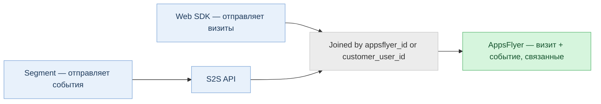

> **At a glance:** API S2S для Web Performance Measurement позволяет отправлять веб-посещения и события в AppsFlyer напрямую с вашего сервера, обходя ограничения браузера, такие как блокировщики рекламы и ограничения cookie. Используйте его вместе с Web SDK или отдельно, чтобы получить более полные и качественные данные атрибуции.

<div id="about-the-s2s-api-for-web-attribution" />

## О S2S API для веб-атрибуции

AppsFlyer поддерживает два способа отправки веб-данных для атрибуции: Web SDK (на стороне клиента) и S2S API (server-to-server, или S2S). Вы можете использовать каждый из этих методов по отдельности или комбинировать их в зависимости от ваших настроек и потребностей.

Web SDK работает в браузере. API S2S вместо этого позволяет отправлять те же данные с вашего собственного бэкенда. Вот почему это важно: браузеры и блокировщики рекламы, ориентированные на конфиденциальность, включая Safari ITP, Firefox ETP и Brave, могут заблокировать или ограничивать измерение на стороне клиента. По оценкам отрасли, блокировка на уровне браузера затрагивает 25–40 % веб-пользователей. Поскольку S2S-запросы инициируются вашим сервером и никогда не проходят через браузер, на них эти ограничения никак не распространяются.

<div id="how-it-works" />

### Как это работает

1. Пользователь посещает ваш веб-сайт или запускает событие в браузере.
2. Ваш сервер получает событие.
3. Ваш сервер отправляет событие непосредственно на сервер AppsFlyer для идентификации.

<div id="why-use-s2s" />

### Зачем использовать S2S

Вот что дает вам использование API S2S, с разбивкой по преимуществам:

* **Измеряйте события на стороне сервера:** Некоторые конверсии вообще не попадают в браузер, например, продление подписки, обрабатываемое в бэкенде , или события, инициированные в CRM-системе. S2S — единственный способ интегрировать их в AppsFlyer и привязать к нужной кампании.
* **Расширенный охват измерений:** Вызовы S2S исходят с вашего сервера, а не из браузера, поэтому к ним не применяются блокировщики рекламы, лимиты cookie Safari ITP и другие браузерные ограничения. Вы можете отслеживать посещения и конверсии, которые невозможно зафиксировать с помощью одних только измерений на стороне клиента.
* **Обогащение данных из бэкенда:** С помощью S2S ваш сервер может добавлять к событиям дополнительные данные перед их отправкой, включая Customer User ID, хешированные адреса электронной почты или номера телефонов, атрибуты CRM, статус подписки или любые внутренние идентификаторы. Это улучшает разрешение идентификаторов и повышает качество сигналов.
* **Безопасность:** Ключи разработчика, пользовательские идентификаторы и любые добавленные данные остаются на вашем сервере и передаются по защищённому соединению, обеспечивая вам полный контроль над тем, что покидает вашу инфраструктуру.

<div id="api-specification" />

## Спецификация API

Базовый URL: `https://events.appsflyer.com`

<div id="authentication" />

### Аутентификация

Все запросы должны содержать действительный токен API S2S и корректный тип контента в заголовках запроса.

| header | Тип | Описание |
| --- | --- | --- |
| `Авторизация` | Ключ API | Ваш токен S2S API включен в заголовок в следующем формате:<br /><br />`Авторизация: Bearer {s2s-token}` |
| `Content-Type` | наименование налога на чистую выручку | Должно быть`application/json` . Обязательно для всех запросов. |

<div id="note" />

> 📘 **Примечание**
>
> Для создания токена API S2S см. инструкции в <Anchor target="_blank" href="/marketers/ru/docs/managing-appsflyer-tokens#управляйте-своими-токенами">разделе «Управление токенами AppsFlyer»</Anchor> .

<div id="measure-an-event" />

### Измерить событие

`POST /v2.0/s2s/inapps/app/web/{appId}`

Измеряет веб- событие (например, покупку, регистрацию или действие клиента) для конкретного приложения.

<Accordion title="Параметры пути">

| Параметр | Необязательно | Описание |
| --- | --- | --- |
| `appId` | Необязательно | `unified_app_id` как определено в AppsFlyer. Например: `website-www.example.com` |

</Accordion>

<Accordion title="Тело запроса">

| Поле | Тип | Необязательно | Описание |
| --- | --- | --- | --- |
| `user_id` | объект | Необязательно | Идентификатор пользователя. Идентификатор пользователя Должен содержать хотя бы один из следующих элементов:`customer_user_id` или`appsflyer_id` . |
| `Установите как TRUE или FALSE` | наименование налога на чистую выручку | Необязательно | Название события Формат: Строка. 1–64 символа. Не может содержать`@ = + -` . Пример: `af_purchase` |
| `event_revenue` | число (двойное) | НЕОБЯЗАТЕЛЬНОЕ | Сумма дохода для событий покупки или монетизации. |
| `SDK (пакет средств разработки ПО)` | строка (ISO-4217) | НЕОБЯЗАТЕЛЬНОЕ | Код валюты для значения дохода. Например: `USD` или `EUR` |
| `event_value` | объект | НЕОБЯЗАТЕЛЬНОЕ | Произвольные параметры события. Поддерживает`custom_parameters` подобъект. |
| `event_url` | наименование налога на чистую выручку | НЕОБЯЗАТЕЛЬНОЕ | URL страницы, где произошло событие. Допустимый URL-адрес HTTP (не более 4096 символов) |
| `Атрибуция` | целое число (int64) | НЕОБЯЗАТЕЛЬНОЕ | Время Unix в миллисекундах (UTC). Если значение не указано, AppsFlyer использует время получения. Если параметр опущен, AppsFlyer использует время получения Окно позднего приёма: события должны поступить не позднее 00:30 следующего календарного дня в часовом поясе приложения. |
| `ip` | наименование налога на чистую выручку | НЕОБЯЗАТЕЛЬНОЕ | IP адрес устройства (IPv4 или IPv6). Максимально 46 символов |
| `user_agent` | наименование налога на чистую выручку | НЕОБЯЗАТЕЛЬНОЕ | Полная строка пользовательского агента из браузера. Максимально 1,024 символов |
| `http_referrer` | наименование налога на чистую выручку | НЕОБЯЗАТЕЛЬНОЕ | URL-адрес страницы, с которой был осуществлен переход. |
| `af_customer_event_id` | наименование налога на чистую выручку | НЕОБЯЗАТЕЛЬНОЕ | Ваш собственный уникальный идентификатор события, который вы используете для дедупликации конверсий на платформах рекламных сетей. AppsFlyer передает его в сеть как идентификатор события.<br /><br />Отправляйте его в любом из следующих случаев:<ul><li>На вашем сайте установлен пиксель рекламной сети, который работает параллельно с системой измерений AppsFlyer.</li><li>Вы отправляете одно и то же событие и через Web SDK, и через этот API.</li></ul>Когда вы его отправляете, также передавайте то же значение в событии пикселя самой сети (например, `eventID` в `fbq()`), чтобы сеть засчитывала конверсию один раз, а не дважды.<br /><br />Если не указать его, AppsFlyer сгенерирует собственный идентификатор, и рекламная сеть не сможет сопоставить события пикселя.<br /><br />**Ограничения:** Максимум 256 символов. Сопоставление выполняется с точным учетом регистра. |
| `email_hashed` | наименование налога на чистую выручку | НЕОБЯЗАТЕЛЬНОЕ | SHA256 нормализованного (в нижнем регистре, без пробелов) адреса электронной почты. Должна представлять собой шестнадцатеричную строку длиной в 64 символа. |
| `phone_number_hashed` | наименование налога на чистую выручку | НЕОБЯЗАТЕЛЬНОЕ | SHA256 номера телефона. Должна представлять собой шестнадцатеричную строку длиной в 64 символа. |
| `phone_number_e164_hashed` | наименование налога на чистую выручку | НЕОБЯЗАТЕЛЬНОЕ | SHA256 номера телефона E.164 (например,`+14155552671` ). Должна представлять собой шестнадцатеричную строку длиной в 64 символа. |
| `first_name_hashed` | наименование налога на чистую выручку | НЕОБЯЗАТЕЛЬНОЕ | SHA256 нормализованной фамилии. Должна представлять собой шестнадцатеричную строку длиной в 64 символа. |
| `last_name_hashed` | наименование налога на чистую выручку | НЕОБЯЗАТЕЛЬНОЕ | SHA256 нормализованной фамилии. Должна представлять собой шестнадцатеричную строку длиной в 64 символа. |

</Accordion>

<Accordion title="Пример запроса">

```json
{"user_id":{"customer_user_id":"15667737-366d-4994-ac8b-653fe6b2be4a"},"event_name":"af_purchase","event_revenue":49.99,"event_revenue_currency":"USD","af_customer_event_id": "550e8400-e29b-41d4-a716-446655440000","event_value":{"af_content_id":"SKU-001","af_quantity":2,"custom_parameters":{"promo_code":"SUMMER10"}},"event_url":"https://example.com/checkout/success","timestamp":1712000000000,"ip":"35.244.183.10","user_agent":"Mozilla/5.0 (Macintosh; Intel Mac OS X 10_15_7) ...","email_hashed":"a1b2c3d4e5f6a1b2c3d4e5f6a1b2c3d4e5f6a1b2c3d4e5f6a1b2c3d4e5f6a1b2"}
```

</Accordion>

<Accordion title="Ответы">

| В. Статус | Обзор |
| --- | --- |
| 202 приняты | Запрос принят. Возвращает статус, сообщение и, при необходимости, опциональный параметр`messageId` . |
| 400 Неверный запрос | Недопустимые или отсутствующие поля. |
| 401 Не авторизовано | Приложение не существует или аутентификация не пройдена. |
| 403 Запрещено | Трафик приложения заблокирован. |
| 415 Неподдерживаемый тип медиа | `Content-Type` должно быть`application/json` . |

</Accordion>

<div id="measure-a-visit" />

### Измерить посещение

`POST /v2.0/s2s/visits/app/web/{appId}`

Измеряет количество посещений страниц для данного веб-приложения. Этот конечный пункт использует все базовые поля, что и конечный пункт событий, с двумя ключевыми отличиями: `event_url` обязательно, а поля имени события и дохода не применяются.

<Accordion title="Параметры пути">

| Параметр | Необязательно | Обзор |
| --- | --- | --- |
| `appId` | Необязательно | `unified_app_id` как определено в AppsFlyer. Например: `website-www.example.com` |

</Accordion>

<Accordion title="Тело запроса">

| Поле | Тип | Необязательно | Обзор |
| --- | --- | --- | --- |
| `user_id` | объект | Необязательно | Идентификатор пользователя. Идентификатор пользователя Должен содержать хотя бы один из следующих элементов:`customer_user_id` или`appsflyer_id` . |
| `event_url` | строка | Необязательно | URL посещенной страницы. Допустимый URL-адрес HTTP (не более 4096 символов) |
| `Атрибуция` | целое число (int64) | НЕОБЯЗАТЕЛЬНОЕ | Время Unix в миллисекундах (UTC). Если значение не указано, AppsFlyer использует время получения. Если параметр опущен, AppsFlyer использует время получения Окно позднего одобрения: заявки на посещение принимаются не позднее 00:30 следующего календарного дня по времени часового пояса приложения. |
| `ip` | строка | НЕОБЯЗАТЕЛЬНОЕ | IP адрес устройства (IPv4 или IPv6). Максимально 46 символов |
| `user_agent` | строка | НЕОБЯЗАТЕЛЬНОЕ | Полная строка пользовательского агента из браузера. Максимально 1,024 символов |
| `http_referrer` | строка | НЕОБЯЗАТЕЛЬНОЕ | URL-адрес страницы, с которой был осуществлен переход. |
| `event_value (значение события)` | объект | НЕОБЯЗАТЕЛЬНОЕ | Произвольные параметры события, включая под-объект`custom_parameters`. |
| `customer_dedup_id` | строка | НЕОБЯЗАТЕЛЬНОЕ | Идентификатор дедупликации, предоставленный клиентом. |
| `email_hashed` | строка | НЕОБЯЗАТЕЛЬНОЕ | SHA256 нормализованного адреса электронной почты. Должна представлять собой шестнадцатеричную строку длиной в 64 символа. |
| `phone_number_hashed` | наименование налога на чистую выручку | НЕОБЯЗАТЕЛЬНОЕ | SHA256 номера телефона. Должна представлять собой шестнадцатеричную строку длиной в 64 символа. |
| `phone_number_e164_hashed` | наименование налога на чистую выручку | НЕОБЯЗАТЕЛЬНОЕ | SHA256 нормализованного имени. Должна представлять собой шестнадцатеричную строку длиной в 64 символа. |
| `first_name_hashed` | наименование налога на чистую выручку | НЕОБЯЗАТЕЛЬНОЕ | SHA256 нормализованной фамилии. Должна представлять собой шестнадцатеричную строку длиной в 64 символа. |
| `last_name_hashed` | наименование налога на чистую выручку | НЕОБЯЗАТЕЛЬНОЕ | SHA256 нормализованной фамилии. Должна представлять собой шестнадцатеричную строку длиной в 64 символа. |

</Accordion>

<Accordion title="Пример запроса">

```json
{"user_id":{"appsflyer_id":"1234567890abcdef","customer_user_id":"15667737-366d-4994-ac8b-653fe6b2be4a"},"event_url":"https://example.com/products/sneakers","timestamp":1712000000000,"ip":"35.244.183.10","user_agent":"Mozilla/5.0 (Windows NT 10.0; Win64; x64) ...","http_referrer":"https://www.google.com/","email_hashed":"a1b2c3d4e5f6a1b2c3d4e5f6a1b2c3d4e5f6a1b2c3d4e5f6a1b2c3d4e5f6a1b2"}
```

</Accordion>

<Accordion title="Ответы">

| В. Статус | Описание |
| --- | --- |
| 202 приняты | Запрос принят. Возвращает статус, сообщение и, при необходимости, опциональный параметр`messageId` . |
| 400 Неверный запрос | Недопустимые или отсутствующие поля. |
| 401 Не авторизовано | Приложение не существует или аутентификация не пройдена. |
| 403 Запрещено | Трафик приложения заблокирован. |
| 415 Неподдерживаемый тип медиа | `Content-Type` должно быть`application/json` . |

</Accordion>

<div id="set-up-a-fully-server-side-integration" />

## Настройте полную интеграцию на стороне сервера.

Если вы запускаете Web SDK совместно с S2S, используйте вместо этого [Извлечение Web SDK afUserID](#extracting-the-web-sdk-afuserid) . Этот раздел предназначен только для интеграций без SDK.

Если на вашем сайте вообще не работает Web SDK , вы несёте ответственность за все, что он обычно делает: присвоение пользовательского cookie, передачу правильных идентификаторов и обеспечение полноты данных каждого события. При правильной настройке вы получите все преимущества, описанные в разделе [«Почему стоит использовать S2S»](#зачем-использовать-s2s) , но это зависит от правильной проработки следующих деталей.

<Accordion title="Отправляйте визиты, а не только события">

Посещение содержит параметры атрибуции, на которых основывается каждое последующее событие, и система ожидает посещения до любого события пользователя. Если вы отправляете событие перед посещением, система классифицирует его как органическое.

</Accordion>

<Accordion title="Присвойте файл cookie первой стороны через HTTP.">

Поскольку на сайте не используется Web SDK, который мог бы установить `afUserId`cookie за вас, назначать и управлять им придётся самостоятельно – это должен быть HTTP-cookie, задаваемый в `Set-Cookie`заголовке ответа, а не cookie на стороне клиента, созданный на JavaScript.

Вот почему это важно: срок действия cookie-файла на стороне клиента (устанавливается через`document.cookie`) истекает быстро: всего за 7 дней в Safari или за 24 часа в доменах, находящихся под управлением ITP. После истечения срока действия идентификатор сбрасывается, и вернувшийся посетитель выглядит как новый. Файл cookie, установленный вашим сервером, не подпадает под это ограничение и может сохраняться в течение максимального срока, установленного браузером (Chrome разрешает до 400 дней). Его также можно пометить`HttpOnly` таким образом, что скрипты страницы и блокировщики рекламы не могут прочитать или удалить его, и он вообще не зависит от каких-либо скриптов, запущенных на странице.

Как задать и прочитать его:

1. При первом запросе от посетителя, у которого нет cookie, сгенерируйте на своем сервере стабильный уникальный идентификатор (например, UUID).
2. Верните его в собственном файле cookie:

   ```
   Set-Cookie: af_web_id=<generated-id>; Max-Age=34128000; Path=/; Secure; HttpOnly; SameSite=Lax
   ```
3. При каждом последующем запросе считывайте значение из входящего заголовка Cookie и используйте его повторно. Не генерируйте его заново.
4. Отправляйте это значение в AppsFlyer при каждом вызове как `appsflyer_id` в составе объекта запроса `user_id`.

Вы можете назвать cookie-файл как угодно; AppsFlyer считывает отправленное вами значение , а не название cookie-файла. Просто убедитесь, что вы указываете его своего собственного домена.

</Accordion>

<Accordion title="При каждом вызове отправляйте правильные идентификаторы.">

Каждый вызов требует объект`user_id`, имеющий хотя бы один из параметров:`appsflyer_id` ( значение cookie) или`customer_user_id` (ваш внутренний идентификатор пользователя). Отправка обоих, если они у вас есть, повышает точность идентификации.

Вот что следует помнить: посещения в основном анонимны, поэтому всегда отправляйте значение cookie. Для событий на сайте добавляйте `customer_user_id` после идентификации пользователя и продолжайте передавать cookie вместе с ним. Для событий, которые не инициируются в браузере, достаточно`customer_user_id`, если AppsFlyer уже знает этого пользователя из ранее идентифицированной сессии.

</Accordion>

<div id="things-to-consider" />

## Что следует учесть

<Accordion title="Идентификация пользователя">

Объект`user_id` требуется при каждом запросе. Необходимо указать хотя бы один из следующих идентификаторов.

| Поле | Тип | Описание |
| --- | --- | --- |
| `Тип конверсии ретаргетинга` | строка (от 1 до 64 символов) | Ваш внутренний идентификатор пользователя, установленный в вашей системе. |
| `appsflyer_id` | строка (минимум 1 символ) | Внутренний идентификатор AppsFlyer для веб-пользователя. Если вы используете AppsFlyer Web SDK, то`appsflyer_id` значение извлекается из cookie-файла Web SDK . Извлечь его из`afUserId` . См. [Извлечение Web SDK afUserIdWeb SDK afUserId](#extracting-the-web-sdk-afuserid) |

</Accordion>

<Accordion title="Поздние сроки принятия">

Информация о мероприятиях и посещениях должна быть получена не позднее 00:30 следующего календарного дня по времени часового пояса приложения. В случае задержки события учитываются по времени получения данных сервером.

</Accordion>

<Accordion title="Хэшированные поля PII">

Все поля с персональными данными должны быть хешированы с помощью алгоритма SHA256 перед отправкой. Перед хешированием выполните нормализацию текста (преобразование в нижний регистр, обрезка). Каждый хеш должен состоять ровно из 64 шестнадцатеричных символов (регистр не имеет значения).

* Шаблон для всех хешированных полей: `^[a-fA-F0-9]{64}$`
* Номера телефонов, использующие поле`phone_number_e164_hashed` должны соответствовать формату E.164 (например,`+14155552671` ) перед хешированием.

</Accordion>

<Accordion title="Извлечение afUserID из веб-SDK">

* `afUserId` — это уникальный идентификатор, устанавливаемый Web SDK при первом посещении пользователем вашего сайта.
* Если вам нужен `afUserId`, воспользуйтесь одним из следующих способов.

<span id="h_01HKW2YAW5FK04C3AWCXGP1XAW"></span>**Получение afUserId из заголовка HTTP cookie**

* Значение `afUserId` отправляется браузером посетителя при обращении к вашему сайту.
* При необходимости извлеките его из заголовка HTTP cookie.

<span id="h_01HKW2YAW5CT2WZ229KJD2FWYK"></span>**Просмотр afUserId в браузере посетителя**

* Просмотрите `afUserId` в браузере посетителя, чтобы устранить неполадки и для отладки.
* Чтобы параметр стал доступен, посетитель должен хотя бы один раз зайти на страницу с веб-SDK.
* Файл cookie, содержащий `afUserId`, является файлом cookie первой стороны по отношению к вашему домену.
* Следующая процедура была подготовлена с использованием Chrome 81. Возможны различия в зависимости от браузера и операционной системы.

**Чтобы получить afUserId из браузера посетителя:**

1. В своём браузере перейдите на свой сайт.
2. Нажмите на правую кнопку мыши, выберите ***Проверить***. Откроется окно браузера для проверки элементов.
3. Перейти на вкладку (A) ***Заявка***.
4. В боковом меню (B) раскройте Cookies.
5. Выберите свой сайт. Если он не отображается, обновите браузер.
6. В поле (C) ***фильтр*** введите `afUserId`. Отобразится значение afUserID.

</Accordion>

<div id="send-events-via-segment-cdp" />

## Отправка событий через Segment (CDP)

**Вы можете использовать Segment для маршрутизации событий в ваш S2S API.** (Segment — это платформа данных о клиентах, инструмент, используемый для сбора клиентских событий и их отправки в настроенные назначения.)

Web SDK и Segment — это два отдельных параллельных пути в AppsFlyer, а не один, подпитывающий другой: Web SDK продолжает отправлять визиты, которые содержат параметры атрибуции, а Segment отправляет события для ресурсов, где нет SDK. Ни один из этих путей не знает о другом; они пересекаются в AppsFlyer, где визит связывается с его событиями с помощью идентификатора, который вы отправляете по обоим путям.



Web SDK и Segment — это два параллельных пути передачи данных в AppsFlyer, связанные общим идентификатором.

<div id="note-1" />

> 📘 **Примечание:**
>
> Здесь рассматриваются **веб**-события, отправляемые по S2S из пользовательского назначения Segment. О мобильной обертке SDK Segment, которая связывает установки приложения и события в приложении с мобильным SDK AppsFlyer, см. статью <Anchor target="_blank" href="/marketers/ru/docs/segment-integration">Интеграция с Segment</Anchor>; это другая интеграция для другой платформы.

<Accordion title="Настройте назначение в Segment">

В AppsFlyer пока нет готового назначения Segment для S2S API, поэтому вам нужно настроить его как пользовательское назначение в Segment, которое будет отправлять каждое событие в конечную точку S2S. Это можно сделать двумя способами — в зависимости от того, насколько большой контроль над форматом данных вам нужен.

<div id="option-1-webhooks-actions-destination" />

#### Вариант 1: назначение Webhooks (Actions)

Это рекомендуемая отправная точка. Код не требуется, а вся настройка выполняется в пользовательском интерфейсе Segment.

Чтобы настроить это, выполните следующее:

1. В Segment добавьте назначение Webhooks из каталога назначений.
2. Подключите его к источнику, который собирает события, которые вы хотите отправить.
3. Для каждого типа события создайте сопоставление, которое определяет URL-адрес AppsFlyer, задаёт метод POST, добавляет необходимые заголовки и формирует JSON-данные из полей события.

<div id="option-2-destination-function" />

#### Вариант 2: функция назначения

Используйте этот параметр только в том случае, если сопоставление Webhooks не может сформировать формат данных, который нужен AppsFlyer. Функция назначения — это небольшая функция JavaScript, которая выполняется в Segment, получает каждое событие и отправляет его в конечную точку AppsFlyer через fetch.

Используйте этот параметр, когда:

* Для данных нужна вложенная структура — например, `user_id`, вложенный в объект `user`, — которую пользовательский интерфейс сопоставления Webhooks не может построить.
* Перед отправкой данные события нужно преобразовать, например изменить формат метки времени.

</Accordion>

<Accordion title="Конечная точка AppsFlyer">

Какой бы вариант настройки вы ни использовали, укажите эту конечную точку:

```
POST https://events.appsflyer.com/v2.0/s2s/inapps/app/web/website-{your_domain}

Authorization: Bearer {s2s-token}
Content-Type: application/json
```

Получите свой ключ API S2S на странице управления токенами AppsFlyer (см. [Аутентификация](#аутентификация)). В пути используйте идентификатор веб-приложения (например, `website-www.your_domain`), а не UUID **Web SDK ID** на странице настроек приложения.

</Accordion>

<Accordion title="Данные для каждого события">

Сформируйте тело JSON для каждого сопоставленного события со следующими полями:

```json
{
  "user_id": {
    "customer_user_id": "<ваш внутренний идентификатор пользователя>",
    "appsflyer_id": "<значение cookie afUserId, если доступно>"
  },
  "event_name": "signup",
  "event_url": "<URL-адрес страницы, на которой произошло событие>",
  "ip": "<IP-адрес конечного пользователя>",
  "user_agent": "<user_agent конечного пользователя>",
  "af_customer_event_id": "<messageId в Segment>"
}
```

</Accordion>

<Accordion title="Два правила, которые обеспечивают работу атрибуции">

1. Web SDK должен работать на маркетинговом сайте: он фиксирует посещения, а Segment передаёт события. Как указано во введении к этому разделу, перед событием у пользователя должно быть посещение, иначе событие будет атрибутировано как органическое. Если вы хотите полностью серверную настройку без использования Web SDK, следуйте инструкциям в разделе [Настройка полностью серверной интеграции](#настройте-полную-интеграцию-на-стороне-сервера).
2. Для каждого запроса также нужны правильные идентификаторы: отправляйте ту же комбинацию `appsflyer_id` и `customer_user_id`, которая описана в разделе [Отправляйте правильные идентификаторы при каждом запросе](#af-accordion-11).

</Accordion>

<Accordion title="Проверьте настройку">

Когда назначение и данные готовы, выполните развертывание в три этапа:

1. Сопоставьте одно или два события в Segment (для начала хорошо подойдет событие регистрации) и отправьте тестовое событие с помощью инструмента проверки сопоставления.
2. Убедитесь, что они корректно отображаются в отчете с необработанными данными и сопоставляются с посещением маркетингового сайта.
3. После подтверждения расширьте сопоставление на остальные события.

</Accordion>

<Accordion title="Рекомендуемый порядок развертывания">

Когда назначение и данные готовы, выполните развертывание в три этапа:

1. Сопоставьте одно или два события в Segment (для начала хорошо подойдет событие регистрации) и отправьте тестовое событие с помощью инструмента проверки сопоставления.
2. Убедитесь, что они корректно отображаются в отчете с необработанными данными и сопоставляются с посещением маркетингового сайта.
3. После подтверждения расширьте сопоставление на остальные события.

</Accordion>

<div data-zendesk-anchors="about-the-s2s-api-for-web-attribution=%D0%BE-s2s-api-%D0%B4%D0%BB%D1%8F-%D0%B2%D0%B5%D0%B1-%D0%B0%D1%82%D1%80%D0%B8%D0%B1%D1%83%D1%86%D0%B8%D0%B8 h_01KP13TF66KEZ7F1TGAA7RGQ6G=%D0%BE-s2s-api-%D0%B4%D0%BB%D1%8F-%D0%B2%D0%B5%D0%B1-%D0%B0%D1%82%D1%80%D0%B8%D0%B1%D1%83%D1%86%D0%B8%D0%B8 how-it-works=%D0%BA%D0%B0%D0%BA-%D1%8D%D1%82%D0%BE-%D1%80%D0%B0%D0%B1%D0%BE%D1%82%D0%B0%D0%B5%D1%82 h_01KP13TF66W8V5A40YT2XYWQ5K=%D0%BA%D0%B0%D0%BA-%D1%8D%D1%82%D0%BE-%D1%80%D0%B0%D0%B1%D0%BE%D1%82%D0%B0%D0%B5%D1%82 why-use-s2s=%D0%B7%D0%B0%D1%87%D0%B5%D0%BC-%D0%B8%D1%81%D0%BF%D0%BE%D0%BB%D1%8C%D0%B7%D0%BE%D0%B2%D0%B0%D1%82%D1%8C-s2s h_01KP13TF671CF85KMYXFZE6W9D=%D0%B7%D0%B0%D1%87%D0%B5%D0%BC-%D0%B8%D1%81%D0%BF%D0%BE%D0%BB%D1%8C%D0%B7%D0%BE%D0%B2%D0%B0%D1%82%D1%8C-s2s api-specification=%D1%81%D0%BF%D0%B5%D1%86%D0%B8%D1%84%D0%B8%D0%BA%D0%B0%D1%86%D0%B8%D1%8F-api h_01KP13TF67N1FVEAD1C7RV25TY=%D1%81%D0%BF%D0%B5%D1%86%D0%B8%D1%84%D0%B8%D0%BA%D0%B0%D1%86%D0%B8%D1%8F-api authentication=%D0%B0%D1%83%D1%82%D0%B5%D0%BD%D1%82%D0%B8%D1%84%D0%B8%D0%BA%D0%B0%D1%86%D0%B8%D1%8F h_01KP13TF67MHPEQ5J3H69RTQH5=%D0%B0%D1%83%D1%82%D0%B5%D0%BD%D1%82%D0%B8%D1%84%D0%B8%D0%BA%D0%B0%D1%86%D0%B8%D1%8F h_01KT98N5SBW812PVXP165FCWR3=%D0%BF%D1%80%D0%B8%D0%BC%D0%B5%D1%87%D0%B0%D0%BD%D0%B8%D0%B5 measure-an-event=%D0%B8%D0%B7%D0%BC%D0%B5%D1%80%D0%B8%D1%82%D1%8C-%D1%81%D0%BE%D0%B1%D1%8B%D1%82%D0%B8%D0%B5 h_01KP13TF67QQC3F1YP9RZRNMTK=%D0%B8%D0%B7%D0%BC%D0%B5%D1%80%D0%B8%D1%82%D1%8C-%D1%81%D0%BE%D0%B1%D1%8B%D1%82%D0%B8%D0%B5 measure-a-visit=%D0%B8%D0%B7%D0%BC%D0%B5%D1%80%D0%B8%D1%82%D1%8C-%D0%BF%D0%BE%D1%81%D0%B5%D1%89%D0%B5%D0%BD%D0%B8%D0%B5 h_01KP13TF68HMD8GSR6GSY95WYF=%D0%B8%D0%B7%D0%BC%D0%B5%D1%80%D0%B8%D1%82%D1%8C-%D0%BF%D0%BE%D1%81%D0%B5%D1%89%D0%B5%D0%BD%D0%B8%D0%B5 h_01KZS2SFULLSVR01=%D0%BD%D0%B0%D1%81%D1%82%D1%80%D0%BE%D0%B9%D1%82%D0%B5-%D0%BF%D0%BE%D0%BB%D0%BD%D1%83%D1%8E-%D0%B8%D0%BD%D1%82%D0%B5%D0%B3%D1%80%D0%B0%D1%86%D0%B8%D1%8E-%D0%BD%D0%B0-%D1%81%D1%82%D0%BE%D1%80%D0%BE%D0%BD%D0%B5-%D1%81%D0%B5%D1%80%D0%B2%D0%B5%D1%80%D0%B0 set-up-a-fully-server-side-integration=%D0%BD%D0%B0%D1%81%D1%82%D1%80%D0%BE%D0%B9%D1%82%D0%B5-%D0%BF%D0%BE%D0%BB%D0%BD%D1%83%D1%8E-%D0%B8%D0%BD%D1%82%D0%B5%D0%B3%D1%80%D0%B0%D1%86%D0%B8%D1%8E-%D0%BD%D0%B0-%D1%81%D1%82%D0%BE%D1%80%D0%BE%D0%BD%D0%B5-%D1%81%D0%B5%D1%80%D0%B2%D0%B5%D1%80%D0%B0 things-to-consider=%D1%87%D1%82%D0%BE-%D1%81%D0%BB%D0%B5%D0%B4%D1%83%D0%B5%D1%82-%D1%83%D1%87%D0%B5%D1%81%D1%82%D1%8C h_01KP13TF68F2T3P7P56A5EG2HW=%D1%87%D1%82%D0%BE-%D1%81%D0%BB%D0%B5%D0%B4%D1%83%D0%B5%D1%82-%D1%83%D1%87%D0%B5%D1%81%D1%82%D1%8C h_01M2T6JS6CPED929FVJS4P4CEG=%D0%BE%D1%82%D0%BF%D1%80%D0%B0%D0%B2%D0%BA%D0%B0-%D1%81%D0%BE%D0%B1%D1%8B%D1%82%D0%B8%D0%B9-%D1%87%D0%B5%D1%80%D0%B5%D0%B7-segment-cdp h_01M2T6JS6CJ75PG72RSRYTCV9N=%D0%BF%D1%80%D0%B8%D0%BC%D0%B5%D1%87%D0%B0%D0%BD%D0%B8%D0%B5-1 h_01M2T6JS6C08V4WZCC9EP724ZG=%D0%B2%D0%B0%D1%80%D0%B8%D0%B0%D0%BD%D1%82-1-%D0%BD%D0%B0%D0%B7%D0%BD%D0%B0%D1%87%D0%B5%D0%BD%D0%B8%D0%B5-webhooks-actions h_01M2T6JS6CZVH4PVH6MK7X5VTZ=%D0%B2%D0%B0%D1%80%D0%B8%D0%B0%D0%BD%D1%82-2-%D1%84%D1%83%D0%BD%D0%BA%D1%86%D0%B8%D1%8F-%D0%BD%D0%B0%D0%B7%D0%BD%D0%B0%D1%87%D0%B5%D0%BD%D0%B8%D1%8F" />
