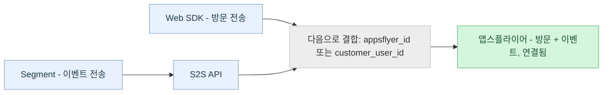

> **At a glance:** 웹 성과 측정을 위한 S2S API를 사용하면 광고 차단기 및 쿠키 제한과 같은 브라우저 제한을 우회하여 서버에서 웹 방문과 이벤트를 앱스플라이어로 직접 전송할 수 있습니다. 더 완전하고 품질 높은 어트리뷰션 데이터를 얻기 위해 웹 SDK와 함께 사용하거나 단독으로 사용할 수 있습니다.

<div id="about-the-s2s-api-for-web-attribution" />

## 웹 어트리뷰션용 S2S API 소개

앱스플라이어는 어트리뷰션을 위해 웹 데이터를 전송하는 두 가지 방법을 지원합니다. 웹 SDK(클라이언트 측)와 S2S API(서버 간, 즉 S2S)입니다. 설정과 요구 사항에 따라 두 방법 중 하나를 독립적으로 사용하거나 함께 조합해 사용할 수 있습니다.

웹 SDK는 브라우저에서 실행됩니다. 대신 S2S API를 사용하면 자체 백엔드에서 동일한 데이터를 전송할 수 있습니다. 그 이유는 다음과 같습니다. Safari ITP, Firefox ETP, Brave를 비롯한 개인정보 보호 중심 브라우저와 광고 차단기가 클라이언트 측 측정을 차단하거나 제한할 수 있기 때문입니다. 업계는 브라우저 수준의 차단은 웹 사용자 중 25&#126;40%에 영향을 미치는 것으로 예측합니다. S2S 호출은 서버에서 시작되고 브라우저를 거치지 않으므로 이러한 제한의 영향을 전혀 받지 않습니다.

<div id="how-it-works" />

### 작동 방법

1. 사용자가 웹사이트를 방문하거나 브라우저에서 이벤트를 트리거합니다.
2. 서버가 이벤트를 수신합니다.
3. 서버가 어트리뷰션을 위해 이벤트를 앱스플라이어 서버로 직접 전송합니다.

<div id="why-use-s2s" />

### S2S를 사용하는 이유

S2S API를 사용할 때 얻을 수 있는 이점을 다음과 같이 정리했습니다:

* **서버 측 이벤트 측정:** 일부 전환은 브라우저를 전혀 거치지 않습니다. 예를 들어 백엔드에서 처리되는 구독 갱신이나 CRM 시스템에서 발생하는 이벤트가 여기에 해당합니다. 이러한 데이터를 앱스플라이어로 가져와 적절한 캠페인과 연결할 수 있는 유일한 방법은 S2S입니다.
* **향상된 측정 범위:** S2S 호출은 브라우저가 아니라 서버에서 이루어지므로 광고 차단기, Safari ITP 쿠키 제한 및 기타 브라우저 수준 제한의 영향을 받지 않습니다. 클라이언트 측 측정만으로는 놓칠 수 있는 방문과 전환을 포착할 수 있습니다.
* **백엔드의 데이터 보강:** S2S를 사용하면 서버가 이벤트를 전송하기 전에 고객 사용자 ID, 해쉬 처리된 이메일 또는 전화번호, CRM 속성, 구독 상태 또는 내부 식별자 등을 포함한 추가 데이터를 이벤트에 추가할 수 있습니다. 이를 통해 ID 식별이 개선되고 신호 품질이 강화됩니다.
* **보안:** Dev 키, 사용자 식별자 및 추가된 모든 데이터는 서버에 유지되며 보안 연결을 통해 전송되므로 인프라에서 외부로 나가는 항목을 완전히 제어할 수 있습니다.

<div id="api-specification" />

## API 사양

기본 URL: `https://events.appsflyer.com`

<div id="authentication" />

### 인증

모든 요청의 요청 헤더에는 유효한 S2S API 토큰과 올바른 콘텐츠 유형이 포함되어야 합니다.

| 헤더 | 유형 | 설명 |
| --- | --- | --- |
| `Authorization` | API 토큰 | S2S API 토큰은 다음 형식으로 헤더에 포함됩니다:<br /><br />`Authorization: Bearer {s2s-token}` |
| `Content-Type` | 스트링 | `application/json`이어야 합니다. 모든 요청에 필요합니다. |

<div id="note" />

> 📘 **노트**
>
> S2S API 토큰을 생성하려면 <Anchor target="_blank" href="/marketers/ko/docs/managing-appsflyer-tokens#토큰-관리">앱스플라이어 토큰 관리</Anchor> 가이드를 참조하세요.

<div id="measure-an-event" />

### 이벤트 측정

`POST /v2.0/s2s/inapps/app/web/{appId}`

지정된 앱의 웹 이벤트(예: 구매, 가입 또는 사용자 지정 작업)를 측정합니다.

<Accordion title="경로 파라미터">

| 파라미터 | 필수 | 설명 |
| --- | --- | --- |
| `appId` | 필수 | 앱스플라이어에서 정의한 `unified_app_id`입니다. 예를 들어: `website-www.example.com` |

</Accordion>

<Accordion title="요청 본문">

| 필드 | 유형 | 필수 | 설명 |
| --- | --- | --- | --- |
| `user_id` | 객체 | 필수 | 사용자 식별자. `customer_user_id` 또는 `appsflyer_id` 중 하나 이상이 포함되어야 합니다. |
| `event_name` | 스트링 | 필수 | 이벤트 이름. 1–64자. `@ = + -`는 포함할 수 없습니다. 예시: `af_purchase` |
| `event_revenue` | 숫자(double) | 선택 사항 | 구매 또는 수익화 이벤트의 수익 금액입니다. |
| `event_revenue_currency` | 스트링(ISO-4217) | 선택 사항 | 수익 값의 통화 코드입니다. 예: `USD` 또는 `EUR`. |
| `event_value` | 객체 | 선택사항 | 자유 형식의 이벤트 파라미터입니다. `custom_parameters` 하위 객체를 지원합니다. |
| `event_url` | 스트링 | 선택 사항 | 이벤트가 발생한 페이지의 URL입니다. 유효한 HTTP URL이며 최대 4,096자까지 허용됩니다. |
| `타임스탬프` | 정수(int64) | 선택사항 | Unix 시간(ms, UTC)입니다. 생략하면 앱스플라이어에서 수신 시간을 사용합니다. 지연 허용 기간: 이벤트는 앱의 시간대를 기준으로 다음 달력일 00:30까지 도착해야 합니다. |
| `ip` | 스트링 | 선택 사항 | 기기의 IP 주소(IPv4 또는 IPv6)입니다. 최대 46자. |
| `user_agent` | 스트링 | 선택 사항 | 브라우저의 전체 사용자 에이전트 스트링입니다. 최대 1,024자입니다. |
| `http_referrer` | 스트링 | 선택사항 | 현재 페이지의 리퍼러 URL입니다. |
| `af_customer_event_id` | 스트링 | 선택 사항 | 애드 네트워크 플랫폼에서 전환을 중복 제거하는 데 사용하는, 이벤트용 고유 ID입니다. 앱스플라이어는 이를 이벤트 ID로 네트워크에 전달합니다.<br /><br />다음 중 하나에 해당하면 전송하세요.<ul><li>사이트에서 앱스플라이어 측정과 함께 네트워크 픽셀을 실행하는 경우.</li><li>동일한 이벤트를 웹 SDK와 이 API를 통해 모두 전송하는 경우.</li></ul>전송할 때 네트워크의 자체 픽셀 이벤트(예: `fbq()`의 `eventID`)에도 동일한 값을 함께 전송해야 네트워크가 전환을 두 번 집계하지 않고 한 번만 집계합니다.<br /><br />생략하면 앱스플라이어가 자체 ID를 생성하며, 네트워크는 귀사의 픽셀 이벤트를 매칭할 수 없습니다.<br /><br />**제한:** 최대 256자입니다. 매칭은 정확히 일치해야 하며 대소문자를 구분합니다. |
| `email_hashed` | 스트링 | 선택 사항 | 정규화된(소문자 변환 및 앞뒤 공백 제거) 이메일의 SHA256 값입니다. 64자 hex 문자열이어야 합니다. |
| `phone_number_hashed` | 스트링 | 선택 사항 | 전화번호의 SHA256 값입니다. 64자 hex 스트링이어야 합니다. |
| `phone_number_e164_hashed` | 스트링 | 선택 사항 | E.164 전화번호(예: `+14155552671`)의 SHA256 값입니다. 64자 hex 스트링이어야 합니다. |
| `first_name_hashed` | 스트링 | 선택 사항 | 정규화된 이름의 SHA256 값입니다. 64자 hex 스트링이어야 합니다. |
| `last_name_hashed` | 스트링 | 선택 사항 | 정규화된 성의 SHA256 값입니다. 64자 hex 스트링이어야 합니다. |

</Accordion>

<Accordion title="요청 예시">

```json
{"user_id":{"customer_user_id":"15667737-366d-4994-ac8b-653fe6b2be4a"},"event_name":"af_purchase","event_revenue":49.99,"event_revenue_currency":"USD","af_customer_event_id": "550e8400-e29b-41d4-a716-446655440000","event_value":{"af_content_id":"SKU-001","af_quantity":2,"custom_parameters":{"promo_code":"SUMMER10"}},"event_url":"https://example.com/checkout/success","timestamp":1712000000000,"ip":"35.244.183.10","user_agent":"Mozilla/5.0 (Macintosh; Intel Mac OS X 10_15_7) ...","email_hashed":"a1b2c3d4e5f6a1b2c3d4e5f6a1b2c3d4e5f6a1b2c3d4e5f6a1b2c3d4e5f6a1b2"}
```

</Accordion>

<Accordion title="응답">

| 상태 | 설명 |
| --- | --- |
| 202 Accepted | 요청이 승인되었습니다. 상태, 메시지 및 선택적 `messageId`를 반환합니다. |
| 400 Bad Request | 유효하지 않거나 누락된 필드입니다. |
| 401 Unauthorized | 앱이 존재하지 않거나 인증에 실패했습니다. |
| 403 Forbidden | 앱 트래픽이 차단되었습니다. |
| 415 Unsupported Media Type | `Content-Type` 이 `application/json`이어야 합니다. |

</Accordion>

<div id="measure-a-visit" />

### 방문 측정

`POST /v2.0/s2s/visits/app/web/{appId}`

지정된 웹 앱의 페이지 방문을 측정합니다. 이 엔드포인트는 이벤트 엔드포인트와 모든 기본 필드를 공유하지만, 두 가지 주요 차이점이 있습니다. `event_url`은 필수이며 이벤트 이름 및 수익 필드는 적용되지 않습니다.

<Accordion title="경로 파라미터">

| 파라미터 | 필수 | 설명 |
| --- | --- | --- |
| `appId` | 필수 | 앱스플라이어에 정의된 `unified_app_id`입니다. 예: `website-www.example.com` |

</Accordion>

<Accordion title="요청 본문">

| 필드 | 유형 | 필수 | 설명 |
| --- | --- | --- | --- |
| `user_id` | 객체 | 필수 | 사용자 식별자입니다. `customer_user_id` 또는 `appsflyer_id` 중 하나 이상을 반드시 포함해야 합니다. |
| `event_url` | 스트링 | 필수 | 방문한 페이지의 URL입니다. 유효한 HTTP URL이며, 최대 4,096자입니다. |
| `타임스탬프` | 정수(int64) | 선택 사항 | Unix 시간(UTC) 밀리초(ms) 단위입니다. 생략하면 앱스플라이어가 수신 시간을 사용합니다. 지연 허용 기간: 방문은 앱의 시간대를 기준으로 다음 달력일 00:30까지 도착해야 합니다. |
| `ip` | 스트링 | 선택 사항 | 기기 IP 주소(IPv4 또는 IPv6)입니다. 최대 46자입니다. |
| `user_agent` | 스트링 | 선택 사항 | 브라우저의 전체 사용자 에이전트 스트링입니다. 최대 1,024자입니다. |
| `http_referrer` | 스트링 | 선택 사항 | 현재 페이지의 리퍼러 URL입니다. |
| `event_value` | 객체 | 선택사항 | `custom_parameters` 하위 객체를 포함한 자유 형식의 이벤트 파라미터입니다. |
| `customer_dedup_id` | 스트링 | 선택 사항 | 고객이 제공한 중복 식별자입니다. |
| `email_hashed` | 문자열 | 선택 사항 | 정규화된 이메일의 SHA256 값입니다. 64자 길이의 hex 스트링이어야 합니다. |
| `phone_number_hashed` | 스트링 | 선택사항 | 전화번호의 SHA256 값입니다. 64자 길이의 hex 스트링이어야 합니다. |
| `phone_number_e164_hashed` | 스트링 | 선택 사항 | E.164 전화번호의 SHA256입니다. 64자 길이의 hex 스트링이어야 합니다. |
| `first_name_hashed` | 스트링 | 선택 사항 | 정규화된 이름의 SHA256입니다. 64자 길이의 hex 스트링이어야 합니다. |
| `last_name_hashed` | 스트링 | 선택사항 | 정규화된 성의 SHA256입니다. 64자 길이의 hex 스트링이어야 합니다. |

</Accordion>

<Accordion title="요청 예시">

```json
{"user_id":{"appsflyer_id":"1234567890abcdef","customer_user_id":"15667737-366d-4994-ac8b-653fe6b2be4a"},"event_url":"https://example.com/products/sneakers","timestamp":1712000000000,"ip":"35.244.183.10","user_agent":"Mozilla/5.0 (Windows NT 10.0; Win64; x64) ...","http_referrer":"https://www.google.com/","email_hashed":"a1b2c3d4e5f6a1b2c3d4e5f6a1b2c3d4e5f6a1b2c3d4e5f6a1b2c3d4e5f6a1b2"}
```

</Accordion>

<Accordion title="응답">

| 상태 | 설명 |
| --- | --- |
| 202 Accepted | 요청이 접수되었습니다. 상태, 메시지 및 선택적 `messageId`를 반환합니다. |
| 400 Bad Request | 유효하지 않거나 누락된 필드가 있습니다. |
| 401 Unauthorized | 앱이 존재하지 않거나 인증에 실패했습니다. |
| 403 Forbidden | 앱 트래픽이 차단되었습니다. |
| 415 Unsupported Media Type | `Content-Type`은 `application/json`이어야 합니다. |

</Accordion>

<div id="set-up-a-fully-server-side-integration" />

## 완전한 서버 측 연동 설정

웹 SDK를 S2S와 함께 실행 중이라면 [웹 SDK afUserID 추출](#extracting-the-web-sdk-afuserid)을 대신 사용하세요. 이 섹션은 SDK 없이 연동하는 경우에만 해당합니다.

사이트에서 Web SDK를 전혀 실행하지 않는 경우, 일반적으로 웹 SDK가 처리하는 모든 작업을 직접 담당해야 합니다. 여기에는 사용자 쿠키 할당, 올바른 식별자 전송, 모든 이벤트 페이로드의 완전성 유지가 포함됩니다. 올바르게 구성하면 [S2S를 사용하는 이유](#s2s를-사용하는-이유)에 설명된 모든 이점을 누릴 수 있지만, 이를 위해서는 이러한 세부 사항을 정확히 설정해야 합니다.

<Accordion title="이벤트만이 아니라 방문도 전송하세요">

방문에는 이후의 모든 이벤트가 의존하는 어트리뷰션 파라미터가 포함되며, 시스템은 모든 사용자 이벤트보다 먼저 방문이 전송되기를 기대합니다. 방문 전에 이벤트를 전송하면 시스템은 이를 오가닉으로 분류합니다.

</Accordion>

<Accordion title="HTTP를 통해 퍼스트 파티 쿠키 할당">

웹 SDK가 `afUserId` 쿠키를 설정해 주지 않으므로, JavaScript로 작성하는 클라이언트 측 쿠키가 아니라 `Set-Cookie` 응답 헤더에 설정된 HTTP 쿠키로 직접 할당하고 관리해야 합니다.

이것이 중요한 이유는 다음과 같습니다. 클라이언트 측 쿠키(`document.cookie`로 설정)는 빠르게 만료되며, Safari에서는 최대 7일, ITP가 적용되는 도메인에서는 24시간만 유지될 수 있습니다. 만료되면 식별자가 재설정되고, 재방문자도 신규 방문자로 보이게 됩니다. 서버에서 설정한 쿠키는 이러한 제한의 대상이 아니며 브라우저의 최대 허용 기간까지 유지될 수 있습니다(Chrome은 최대 400일까지 허용). 또한 `HttpOnly`로 표시할 수 있으므로 페이지 스크립트나 광고 차단기가 이를 읽거나 제거할 수 없고, 페이지에서 스크립트가 실행되는지 여부에도 전혀 의존하지 않습니다.

설정 및 읽기 방법:

1. 쿠키가 없는 방문자의 첫 요청 시, 서버에서 안정적이고 고유한 ID(예: UUID)를 생성합니다.
2. 퍼스트 파티 쿠키로 반환합니다:

   ```
   Set-Cookie: af_web_id=<generated-id>; Max-Age=34128000; Path=/; Secure; HttpOnly; SameSite=Lax
   ```
3. 이후 모든 요청에서는 들어오는 Cookie 헤더에서 값을 읽어 재사용합니다. 다시 생성하지 마세요.
4. 각 호출마다 요청의 `user_id` 객체의 `appsflyer_id`로 해당 값을 앱스플라이어에 전송하세요.

쿠키 이름은 원하는 대로 지정할 수 있습니다. 앱스플라이어는 쿠키 이름이 아니라 전송한 값을 읽습니다. 자사 퍼스트 파티 도메인에서 설정하기만 하면 됩니다.

</Accordion>

<Accordion title="각 호출에 올바른 식별자 전송">

모든 호출에는 `appsflyer_id`(쿠키 값) 또는 `customer_user_id`(내부 사용자 ID) 중 하나 이상이 포함된 `user_id` 객체가 필요합니다. 가능한 경우 두 값을 모두 전송하면 ID 식별이 향상됩니다.

다음 사항을 유념하세요. 방문은 대부분 익명이므로 항상 쿠키 값을 전송해야 합니다. 사이트 내 이벤트의 경우 사용자가 식별되면 `customer_user_id`를 추가하고, 쿠키도 함께 계속 전송하세요. 브라우저에서 발생하지 않은 이벤트의 경우, 앱스플라이어가 이전에 식별된 세션을 통해 해당 사용자를 이미 알고 있다면 `customer_user_id`만으로도 충분합니다.

</Accordion>

<div id="things-to-consider" />

## 고려 사항

<Accordion title="사용자 식별">

모든 요청에는 `user_id` 객체가 필요합니다. 다음 식별자 중 하나 이상을 제공해야 합니다.

| 필드 | 유형 | 설명 |
| --- | --- | --- |
| `customer_user_id` | 스트링(1&#126;64자) | 시스템에 설정된 내부 사용자 식별자입니다. |
| `appsflyer_id` | 스트링(최소 1자) | 웹 사용자를 위한 앱스플라이어 내부 식별자입니다. 앱스플라이어 웹 SDK를 사용하는 경우 `appsflyer_id` 값은 Web SDK 쿠키에서 가져옵니다. `afUserId`에서 추출하세요. [Web SDK afUserId 추출](#extracting-the-web-sdk-afuserid)을 참조하세요 |

</Accordion>

<Accordion title="늦은 승인 기간">

이벤트와 방문은 앱의 시간대 기준으로 다음 날 00:30까지 수신되어야 합니다. 늦게 도착한 이벤트에는 서버 수신 시간이 적용됩니다.

</Accordion>

<Accordion title="해싱된 PII 필드">

모든 개인 데이터 필드는 전송 전에 SHA256으로 해싱되어야 합니다. 해싱하기 전에 텍스트를 정규화하세요(소문자 변환, 앞뒤 공백 제거). 각 해시는 정확히 64개의 16진수 문자(대소문자 구분 없음)여야 합니다.

* 모든 해쉬 필드의 패턴: `^[a-fA-F0-9]{64}$`
* `phone_number_e164_hashed` 필드를 사용하는 전화번호는 해싱 전에 E.164 형식(예: `+14155552671`)을 준수해야 합니다.

</Accordion>

<Accordion title="웹 SDK에서 afUserID 추출">

* `afUserId` 파라미터는 사용자가 사이트를 최초 방문할 때 웹 SDK가 설정하는 고유 식별자입니다.
* `afUserId`가 필요하면 아래 방법 중 하나를 사용하세요.

<span id="h_01HKW2YAW5FK04C3AWCXGP1XAW"></span>**HTTP 쿠키 헤더에서 afUserId 획득**

* 방문자의 브라우저가 사이트로 요청을 보낼 때 `afUserId`가 전송됩니다.
* 필요하다면 HTTP 쿠키 헤더에서 추출하십시오.

<span id="h_01HKW2YAW5CT2WZ229KJD2FWYK"></span>**방문자 브라우저에서 afUserId 확인**

* 문제 해결 및 디버깅을 위해 방문자 브라우저에서 `afUserId`를 확인할 수 있습니다.
* 이 값이 사용 가능하려면 방문자가 웹 SDK가 포함된 페이지를 최소 한 번은 방문한 적이 있어야 합니다.
* `afUserId`를 포함하는 쿠키는 귀사 도메인 기준의 자사 쿠키입니다.
* 다음 절차는 Chrome 81을 사용해 작성되었습니다. 브라우저와 운영 체제에 따라 차이가 있을 수 있습니다.

**방문자 브라우저에서 afUserId 가져오는 방법:**

1. 브라우저에서 귀하의 웹사이트로 이동하십시오.
2. 마우스 오른쪽 버튼을 클릭한 다음 ***검사***를 선택합니다. 브라우저의 요소 검사 창이 나타납니다.
3. (A) ***Application*** 탭으로 이동하세요.
4. 측면 메뉴에서 (B) 쿠키를 확장하세요.
5. 웹사이트를 선택하세요. 표시되지 않으면 브라우저를 새로고침하세요.
6. (C) ***filter*** 필드에 `afUserId`를 입력하세요. afUserID 값이 표시됩니다.

</Accordion>

<div id="send-events-via-segment-cdp" />

## Segment(CDP)를 통해 이벤트 전송

**Segment를 사용해 이벤트를 S2S API로 라우팅할 수 있습니다.** (Segment는 고객 이벤트를 수집해 구성된 대상에 전송하는 데 사용되는 도구인 고객 데이터 플랫폼입니다.)

Web SDK와 Segment는 하나가 다른 하나로 데이터를 전달하는 구조가 아니라, 앱스플라이어로 들어가는 서로 분리된 두 개의 병렬 경로입니다. Web SDK는 어트리뷰션 파라미터를 포함하는 방문을 계속 전송하고, Segment는 SDK가 없는 속성의 이벤트를 전송합니다. 두 경로는 서로를 알지 못하며, 앱스플라이어에서 만납니다. 앱스플라이어는 양쪽에서 전송한 식별자를 사용해 방문을 해당 이벤트와 연결합니다.



Web SDK와 Segment는 앱스플라이어로 들어가는 두 개의 병렬 경로이며, 공통 식별자로 연결됩니다.

<div id="note-1" />

> 📘 **노트**
>
> 여기서는 Segment 사용자 지정 대상에서 S2S를 통해 전송되는 **웹** 이벤트를 다룹니다. 앱 설치 및 인앱 이벤트를 앱스플라이어 모바일 SDK에 연결하는 Segment의 모바일 SDK 래퍼에 대해서는 <Anchor target="_blank" href="/marketers/ko/docs/segment-integration">Segment integration</Anchor>을 참조하세요. 이는 다른 플랫폼을 위한 별도의 연동입니다.

<Accordion title="Segment에서 대상 설정">

앱스플라이어에는 아직 S2S API용으로 사전 구축된 Segment 대상이 없으므로, Segment에서 각 이벤트를 S2S 엔드포인트로 전송하는 사용자 지정 대상으로 설정해야 합니다. 데이터 형식을 얼마나 세밀하게 컨트롤해야 하는지에 따라 두 가지 방법이 있습니다.

<div id="option-1-webhooks-actions-destination" />

#### 옵션 1: Webhooks(Actions) 목적지

권장되는 시작 방법입니다. 코드가 필요 없으며, 모든 설정은 Segment 사용자 인터페이스에서 이루어집니다.

설정 방법:

1. Segment에서 대상 카탈로그의 Webhooks 대상을 추가하세요.
2. 전송하려는 이벤트를 수집하는 소스에 연결하세요.
3. 각 이벤트 유형에 대해 앱스플라이어 URL을 정의하고, 메서드를 POST로 설정하고, 필요한 헤더를 추가하고, 이벤트 필드에서 JSON 페이로드를 구성하는 매핑을 생성하세요.

<div id="option-2-destination-function" />

#### 옵션 2: 목적지 함수

Webhooks 매핑으로 앱스플라이어에 필요한 페이로드 형식을 만들 수 없는 경우에만 이 옵션을 사용하세요. 목적지 함수는 Segment 내에서 실행되는 작은 JavaScript 함수로, 각 이벤트를 받아 fetch를 사용해 앱스플라이어 엔드포인트로 전송합니다.

다음과 같은 경우 이 옵션을 사용하세요:

* Webhooks 매핑 사용자 인터페이스로는 만들 수 없는 중첩 구조의 페이로드가 필요한 경우(예: `user` 객체 안에 `user_id`를 래핑하는 경우).
* 전송 전에 이벤트 데이터를 변환해야 하는 경우(예: 타임스탬프를 다른 형식으로 변환).

</Accordion>

<Accordion title="앱스플라이어 엔드포인트">

어떤 설정을 사용하든 이 엔드포인트를 사용하도록 설정하세요:

```
POST https://events.appsflyer.com/v2.0/s2s/inapps/app/web/website-{your_domain}

Authorization: Bearer {s2s-token}
Content-Type: application/json
```

앱스플라이어 토큰 관리 페이지에서 S2S API 키를 가져오세요([Authentication](#인증) 참조). 경로에는 앱 설정 페이지의 **웹 SDK ID** UUID가 아니라 웹 앱 ID(예: `website-www.your_domain`)를 사용하세요.

</Accordion>

<Accordion title="이벤트별 페이로드">

매핑된 각 이벤트의 JSON 본문은 다음 필드로 구성하세요:

```json
{
  "user_id": {
    "customer_user_id": "<your internal user ID>",
    "appsflyer_id": "<afUserId cookie value, when available>"
  },
  "event_name": "signup",
  "event_url": "<page URL where the event happened>",
  "ip": "<end-user IP>",
  "user_agent": "<end-user user agent>",
  "af_customer_event_id": "<Segment messageId>"
}
```

</Accordion>

<Accordion title="어트리뷰션이 작동하도록 하는 두 가지 규칙">

1. 마케팅 사이트에서 웹 SDK를 계속 실행하세요. 방문은 웹 SDK가 기록하고, 이벤트는 Segment가 전달합니다. 이 섹션의 소개에서 설명했듯이, 사용자는 이벤트 전에 방문이 있어야 합니다. 그렇지 않으면 이벤트가 오가닉으로 어트리뷰션됩니다. 대신 웹 SDK 없이 완전한 서버 사이드 설정을 원한다면 [완전한 서버 사이드 연동 설정](#완전한-서버-측-연동-설정)을 따르세요.
2. 모든 호출에는 적절한 식별자도 함께 필요합니다. [호출 시마다 올바른 식별자 전송하기](#af-accordion-11)에 설명된 것과 동일한 `appsflyer_id` 또는 `customer_user_id` 조합을 전송하세요.

</Accordion>

<Accordion title="설정 확인">

목적지와 페이로드를 준비한 후에는 다음 세 단계로 배포하세요:

1. Segment에서 한두 개의 이벤트를 매핑하고(가입 이벤트가 좋은 첫 후보입니다) 매핑 테스터에서 테스트 이벤트를 전송하세요.
2. 이벤트가 로우 리포트에 올바르게 도착했는지, 그리고 마케팅 사이트 방문과 일치하는지 확인하세요.
3. 확인이 완료되면 나머지 이벤트로 매핑을 확장하세요.

</Accordion>

<Accordion title="권장 롤아웃">

대상과 페이로드가 준비되면 다음 세 단계로 롤아웃하세요:

1. Segment에서 한두 개의 이벤트를 매핑하고(가입 이벤트가 좋은 첫 후보입니다) 매핑 테스터에서 테스트 이벤트를 전송하세요.
2. 이벤트가 로우 리포트에 올바르게 도착했는지, 그리고 마케팅 사이트 방문과 일치하는지 확인하세요.
3. 확인이 완료되면 나머지 이벤트로 매핑을 확장하세요.

</Accordion>

<div data-zendesk-anchors="about-the-s2s-api-for-web-attribution=%EC%9B%B9-%EC%96%B4%ED%8A%B8%EB%A6%AC%EB%B7%B0%EC%85%98%EC%9A%A9-s2s-api-%EC%86%8C%EA%B0%9C h_01KP13TF66KEZ7F1TGAA7RGQ6G=%EC%9B%B9-%EC%96%B4%ED%8A%B8%EB%A6%AC%EB%B7%B0%EC%85%98%EC%9A%A9-s2s-api-%EC%86%8C%EA%B0%9C how-it-works=%EC%9E%91%EB%8F%99-%EB%B0%A9%EB%B2%95 h_01KP13TF66W8V5A40YT2XYWQ5K=%EC%9E%91%EB%8F%99-%EB%B0%A9%EB%B2%95 why-use-s2s=s2s%EB%A5%BC-%EC%82%AC%EC%9A%A9%ED%95%98%EB%8A%94-%EC%9D%B4%EC%9C%A0 h_01KP13TF671CF85KMYXFZE6W9D=s2s%EB%A5%BC-%EC%82%AC%EC%9A%A9%ED%95%98%EB%8A%94-%EC%9D%B4%EC%9C%A0 api-specification=api-%EC%82%AC%EC%96%91 h_01KP13TF67N1FVEAD1C7RV25TY=api-%EC%82%AC%EC%96%91 authentication=%EC%9D%B8%EC%A6%9D h_01KP13TF67MHPEQ5J3H69RTQH5=%EC%9D%B8%EC%A6%9D h_01KT98N5SBW812PVXP165FCWR3=%EB%85%B8%ED%8A%B8 measure-an-event=%EC%9D%B4%EB%B2%A4%ED%8A%B8-%EC%B8%A1%EC%A0%95 h_01KP13TF67QQC3F1YP9RZRNMTK=%EC%9D%B4%EB%B2%A4%ED%8A%B8-%EC%B8%A1%EC%A0%95 measure-a-visit=%EB%B0%A9%EB%AC%B8-%EC%B8%A1%EC%A0%95 h_01KP13TF68HMD8GSR6GSY95WYF=%EB%B0%A9%EB%AC%B8-%EC%B8%A1%EC%A0%95 h_01KZS2SFULLSVR01=%EC%99%84%EC%A0%84%ED%95%9C-%EC%84%9C%EB%B2%84-%EC%B8%A1-%EC%97%B0%EB%8F%99-%EC%84%A4%EC%A0%95 set-up-a-fully-server-side-integration=%EC%99%84%EC%A0%84%ED%95%9C-%EC%84%9C%EB%B2%84-%EC%B8%A1-%EC%97%B0%EB%8F%99-%EC%84%A4%EC%A0%95 things-to-consider=%EA%B3%A0%EB%A0%A4-%EC%82%AC%ED%95%AD h_01KP13TF68F2T3P7P56A5EG2HW=%EA%B3%A0%EB%A0%A4-%EC%82%AC%ED%95%AD h_01M2T6JS6CPED929FVJS4P4CEG=segmentcdp%EB%A5%BC-%ED%86%B5%ED%95%B4-%EC%9D%B4%EB%B2%A4%ED%8A%B8-%EC%A0%84%EC%86%A1 h_01M2T6JS6CJ75PG72RSRYTCV9N=%EB%85%B8%ED%8A%B8-1 h_01M2T6JS6C08V4WZCC9EP724ZG=%EC%98%B5%EC%85%98-1-webhooksactions-%EB%AA%A9%EC%A0%81%EC%A7%80 h_01M2T6JS6CZVH4PVH6MK7X5VTZ=%EC%98%B5%EC%85%98-2-%EB%AA%A9%EC%A0%81%EC%A7%80-%ED%95%A8%EC%88%98" />
